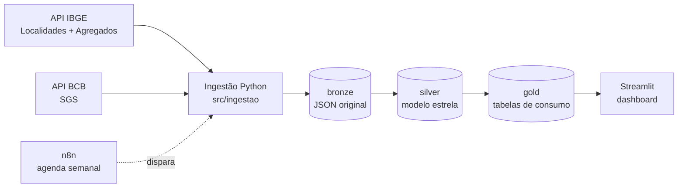

# Radar de Expansão

> **Status:** em construção — Etapa 1 (planejamento). Seções marcadas com _(a preencher)_ serão completadas ao longo do projeto.

Sistema que cruza dados oficiais do **IBGE** e do **Banco Central** para responder a uma pergunta de negócio:
**onde abrir a próxima unidade — e se o momento econômico favorece abrir agora ou esperar.**

Projeto Integrador do Data Challenger 2 da Pós Tech em Engenharia de Dados & IA, no cenário da consultoria fictícia **Bússola Pública**.

- **Repositório:** https://github.com/JJ-Junior/radar-expansao
- **Dashboard publicado:** em breve
- **Entrega:** 20/12/2026

---

## 1. O problema

Redes de varejo e serviços decidem a abertura de novas unidades no "feeling": a cidade "parece estar crescendo", "o concorrente abriu lá".
Os dados para uma decisão melhor são públicos e gratuitos, mas chegam espalhados, em JSON aninhado, com periodicidades diferentes
(censo decenal, estimativa anual, PIB com dois anos de atraso, IPCA mensal, dólar diário) e sem histórico organizado.
O Radar de Expansão captura essas fontes, organiza em camadas e entrega um ranking de municípios explicável.

## 2. O cliente escolhido

**Rede de academias.** Academia é um gasto que o aluno corta primeiro quando o orçamento aperta, então o ranking cruza
tamanho de mercado com poder de compra, concorrência (academias por habitante) e crescimento, e o momento econômico
(Selic, IPCA e dólar, que encarece equipamentos importados) indica se é hora de expandir. Detalhes em [`prd.md`](prd.md).

## 3. Arquitetura



Detalhes completos (endpoints, modelo das tabelas, regras de transformação, lotes e carga incremental) em [`spec.md`](spec.md).

## 4. Dashboard

- **Link do app publicado:** em breve
- **Prints:** _(a preencher — imagens em `docs/img/`)_

## 5. Como rodar o projeto

_(roteiro completo em [`spec.md`](spec.md#10-stack-e-como-rodar); resumo abaixo)_

```powershell
git clone https://github.com/JJ-Junior/radar-expansao.git
cd radar-expansao
python -m venv .venv
.\.venv\Scripts\Activate.ps1
pip install -r requirements.txt
Copy-Item .env.example .env   # preencha com as credenciais do seu banco
```

A conexão com o Supabase usa o **Session pooler** (IPv4): a conexão direta do Supabase é só IPv6 e falha em várias redes
e no Streamlit Cloud. Os campos estão explicados no [`.env.example`](.env.example).

Comandos de carga, transformação e do dashboard: _(a preencher quando os scripts existirem)_.

## 6. Estrutura do repositório

| Pasta / arquivo | Conteúdo |
|---|---|
| `prd.md` | O que o cliente quer: perguntas de negócio, critérios e pesos do ranking |
| `spec.md` | Como construímos: arquitetura, APIs, modelo de dados, regras de transformação |
| `agents.md` | Regras da casa para o assistente de IA |
| `prompts/` | Registro dos principais prompts por etapa |
| `sql/` | DDL e transformações das camadas bronze, silver e gold |
| `src/ingestao/` | Coleta das APIs → bronze |
| `src/transformacao/` | Bronze → silver → gold |
| `src/app/` | Dashboard Streamlit |
| `n8n/` | Workflow de automação exportado (sem credenciais) |
| `site/` | Site de apoio (documentação + vitrine de dados) |
| `docs/img/` | Prints do dashboard e da execução do n8n |

## 7. Fontes de dados

- **IBGE** — API de Localidades e API de Agregados v3 (`servicodados.ibge.gov.br`): população estimada, Censo 2022, PIB dos Municípios, IPCA, Cadastro Central de Empresas.
- **Banco Central do Brasil** — Sistema Gerenciador de Séries Temporais (SGS, `api.bcb.gov.br`): meta da Selic e câmbio do dólar.

## 8. Como eu usei IA neste projeto

_(a preencher ao longo do projeto)_ — o processo segue três documentos escritos antes do código
(`prd.md`, `spec.md`, `agents.md`) e o registro dos prompts em [`prompts/`](prompts/README.md):
o que foi pedido, o que o assistente de IA entregou e o que o squad precisou ajustar.

## 9. Squad

_(a preencher)_
