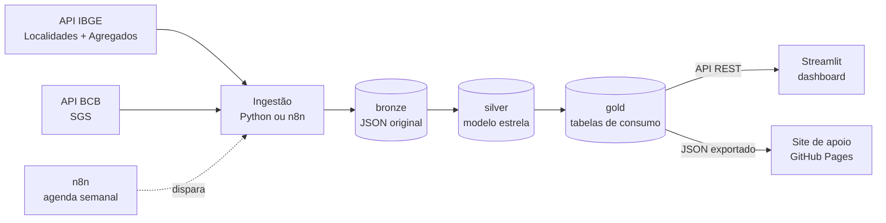

# Radar de Expansão

> **Status:** em construção. Seções marcadas com _(a preencher)_ serão completadas ao longo do projeto.
>
> | Etapa | Situação |
> |---|---|
> | 1 · Planejamento (`prd.md`, `spec.md`, `agents.md`) | ✅ rascunhos em revisão pelo squad |
> | 2 · Exploração das APIs | ✅ concluída (achados em `spec.md`, seção 2) |
> | 3 · Camada bronze (ingestão em Python) | ✅ concluída: 13 recursos carregados no banco do projeto; incremental sem duplicar |
> | 4 · Camada silver (modelo estrela) | ✅ concluída: 5 dimensões, 2 fatos, 12 testes de qualidade passando |
> | 5 · Camada gold (ranking, contexto macro, semáforo) | ✅ concluída: tabelas de consumo + parâmetros do ranking, 14 testes de qualidade passando |
> | 6 · n8n · 7 · Streamlit | ⏳ próximas etapas |
> | Extra · Site de apoio | ✅ publicado com prévia dos dados |

Sistema que cruza dados oficiais do **IBGE** e do **Banco Central** para responder a uma pergunta de negócio:
**onde abrir a próxima unidade — e se o momento econômico favorece abrir agora ou esperar.**

Projeto Integrador do Data Challenger 2 da Pós Tech em Engenharia de Dados & IA, no cenário da consultoria fictícia **Bússola Pública**.

- **Repositório:** https://github.com/JJ-Junior/radar-expansao
- **Dashboard publicado:** em breve
- **Entrega:** 20/12/2026

---

## 1. O problema

Redes de varejo e serviços decidem a abertura de novas unidades no "feeling": a cidade "parece estar crescendo", "o concorrente abriu lá".
Os dados para uma decisão melhor são públicos e gratuitos, mas chegam espalhados, em JSON aninhado, com periodicidades diferentes
(censo decenal, estimativa anual, PIB com dois anos de atraso, IPCA mensal, dólar diário) e sem histórico organizado.
O Radar de Expansão captura essas fontes, organiza em camadas e entrega um ranking de municípios explicável.

## 2. O cliente escolhido

**Rede de academias.** Academia é um gasto que o aluno corta primeiro quando o orçamento aperta, então o ranking cruza
tamanho de mercado com poder de compra, concorrência (academias por habitante) e crescimento, e o momento econômico
(Selic, IPCA e dólar, que encarece equipamentos importados) indica se é hora de expandir. Detalhes em [`prd.md`](prd.md).

## 3. Arquitetura



**Supabase e n8n autohospedados via Docker.** O dashboard lê só a camada gold, pela API REST do Supabase, com permissão somente leitura.

Detalhes completos (endpoints, modelo das tabelas, regras de transformação, lotes, carga incremental e os dois cenários de ingestão) em [`spec.md`](spec.md).

## 4. Infraestrutura (Supabase e n8n autohospedados via Docker)

O banco (Supabase) e a automação (n8n) rodam em containers Docker num servidor próprio, sem nenhuma porta exposta na internet:

- **Supabase em perfil enxuto:** Postgres, API REST, gateway e Studio — só o necessário para o Lakehouse.
- **API REST restrita:** expõe somente o schema `gold`, por um papel somente leitura com RLS; é por ela que o dashboard lê os dados.
- **n8n** com versão fixa, fuso `America/Sao_Paulo` e limpeza automática do histórico de execuções.
- **Acesso** pelos desenvolvedores via túnel SSH; backup diário das três camadas com teste de restauração.

Guia passo a passo, com pré-requisitos, geração de segredos, SQL inicial, backup e problemas comuns:
[`docs/instalacao.md`](docs/instalacao.md). Modelos de configuração (só com marcadores, sem segredos) em [`infra/`](infra/).

## 5. Dashboard

- **Link do app publicado:** em breve
- **Prints:** _(a preencher — imagens em `docs/img/`)_

## 6. Como rodar o projeto

_(roteiro completo em [`spec.md`](spec.md#10-stack-e-como-rodar); resumo abaixo)_

**Passo 0 — subir a infraestrutura:** Supabase e n8n via Docker, papéis e schemas criados, conforme
[`docs/instalacao.md`](docs/instalacao.md). Com o túnel SSH aberto, o banco fica acessível em `localhost:5432`.

**Passo 1 — ambiente local:**

```powershell
git clone https://github.com/JJ-Junior/radar-expansao.git
cd radar-expansao
python -m venv .venv
.\.venv\Scripts\Activate.ps1
pip install -r requirements.txt
Copy-Item .env.example .env   # preencha com as credenciais do seu banco
Copy-Item .streamlit\secrets.toml.example .streamlit\secrets.toml   # segredos do dashboard
```

Os campos estão explicados no [`.env.example`](.env.example) e no [`.streamlit/secrets.toml.example`](.streamlit/secrets.toml.example).

**Passo 2 — criar as tabelas da bronze** (idempotente; roda os arquivos de `sql/bronze/` na ordem):

```powershell
python -m src.transformacao.criar_estrutura --camadas bronze
```

**Passo 3 — carga da bronze** (cenário A, Python):

```powershell
python -m src.ingestao.carga_inicial          # todo o histórico do IBGE e do BCB, em lotes
python -m src.ingestao.carga_incremental      # só o que é novo ou foi revisado (o que o n8n roda toda semana)
```

Cada fonte também roda sozinha (`--fonte ibge` ou `--fonte bcb`, ou `python -m src.ingestao.bcb_sgs --modo incremental`).
Ao final, o terminal mostra uma tabela por recurso (status, chamadas, respostas novas, segundos), e o mesmo resultado fica em
`bronze.execucao`. Rodar de novo não duplica nada: respostas iguais são reconhecidas pelo hash.

**Passo 4 — camada silver** (cria as tabelas, transforma a bronze e roda os testes de qualidade):

```powershell
python -m src.transformacao.criar_estrutura --camadas silver
python -m src.transformacao.executar
```

A transformação é a função SQL `silver.atualizar()`: "achata" o JSON do IBGE em município + ano + valor, converte tipos,
troca os símbolos da fonte (`-`, `...`, `X`, `..`) por nulo com uma flag explicando o motivo e grava sem duplicar.
Ao final, o terminal mostra os 12 testes de qualidade (esperado × obtido); se algum falhar, o comando termina com erro.

**Passo 5 — camada gold** (ranking, indicadores por município, contexto macro e semáforo):

```powershell
python -m src.transformacao.criar_estrutura --camadas gold
python -m src.transformacao.executar            # silver + gold, com os testes de cada camada
```

A gold é recalculada inteira pela função SQL `gold.atualizar()` seguindo as regras do [`prd.md`](prd.md) (seção 4):
notas de 0 a 100 por percentil, peso redistribuído quando falta dado, espaço competitivo limitado aos percentis 5% e 95%,
e as **5 unidades recomendadas com renda acima da mediana do universo e no máximo uma cidade por região imediata**. Ao final, o terminal mostra os testes,
as 5 recomendadas, o top 10 e o semáforo do momento econômico.

**Passos seguintes** — automação no n8n e dashboard: _(a preencher quando as etapas forem concluídas)_.

## 7. Estrutura do repositório

| Pasta / arquivo | Conteúdo |
|---|---|
| `prd.md` | O que o cliente quer: perguntas de negócio, critérios e pesos do ranking |
| `spec.md` | Como construímos: arquitetura, APIs, modelo de dados, regras de transformação |
| `agents.md` | Regras da casa para o assistente de IA |
| `prompts/` | Registro dos principais prompts por etapa |
| `sql/` | DDL e transformações das camadas bronze, silver e gold |
| `src/ingestao/` | Coleta das APIs → bronze |
| `src/transformacao/` | Bronze → silver → gold |
| `src/app/` | Dashboard Streamlit |
| `n8n/` | Workflow de automação exportado (sem credenciais) |
| `site/` | Site de apoio (documentação + vitrine de dados) |
| `infra/` | Modelos de configuração do Supabase e do n8n, SQL inicial de papéis e script de backup |
| `docs/instalacao.md` | Guia de instalação da infraestrutura |
| `docs/responsabilidades.md` | Frentes de trabalho, tarefas e prazos do squad |
| `docs/img/` | Prints do dashboard e da execução do n8n |

## 8. Fontes de dados

- **IBGE** — API de Localidades e API de Agregados v3 (`servicodados.ibge.gov.br`): população estimada, Censo 2022, PIB dos Municípios, IPCA, Cadastro Central de Empresas.
- **Banco Central do Brasil** — Sistema Gerenciador de Séries Temporais (SGS, `api.bcb.gov.br`): meta da Selic e câmbio do dólar.

## 9. Como eu usei IA neste projeto

_(a preencher ao longo do projeto)_ — o processo segue três documentos escritos antes do código
(`prd.md`, `spec.md`, `agents.md`) e o registro dos prompts em [`prompts/`](prompts/README.md):
o que foi pedido, o que o assistente de IA entregou e o que o squad precisou ajustar.

## 10. Squad

**DROP Database — Squad #21001**

- José Martins (Junior)
- Marco Pereira
- Mario Castilho
- Rodrigo Oliveira (Rodrigo Cesar Silva De Oliveira)
- Rodrigo Vincensi

Frentes, tarefas, prazos e forma de trabalho do squad: [`docs/responsabilidades.md`](docs/responsabilidades.md).
