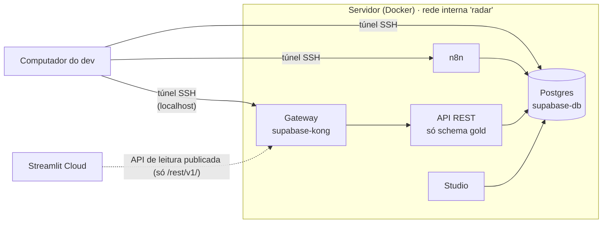

# Instalação da infraestrutura — Supabase e n8n autohospedados via Docker

Guia para reproduzir o ambiente do Radar de Expansão num servidor próprio (ou no seu computador).
Os arquivos de modelo citados aqui estão em [`infra/`](../infra/). Todos os endereços aparecem como `<marcadores>`:
troque pelos seus valores e **nunca** versione `.env`, senhas ou tokens.

> ⏳ **validar após a instalação** marca comandos que ainda estão sendo conferidos na instalação real do projeto
> (podem mudar conforme a versão do Supabase ou do n8n).

**Visão geral**



Nenhuma porta é publicada para a rede ou para a internet: tudo escuta em `127.0.0.1` do servidor.

---

## 1. Pré-requisitos

| Item | Mínimo | Recomendado |
|---|---|---|
| Sistema | Linux x86-64 (Ubuntu LTS testado) | — |
| Memória livre | ~4 GB (perfil enxuto do Supabase + n8n) | 6–8 GB |
| Disco livre | 15 GB (imagens + dados + backups) | 30 GB |
| Ferramentas | Docker Engine + plugin Compose 2.24 ou superior, `git`, `openssl` | — |

**Alternativa para teste local (Windows ou macOS):** instale o [Docker Desktop](https://docs.docker.com/desktop/), que já traz o
Compose, e reserve pelo menos 4 GB de memória para ele (Settings → Resources). Os comandos abaixo funcionam no terminal do
Docker Desktop; no Windows, rode os scripts `.sh` pelo Git Bash ou pelo WSL.

### 1.1 Docker Engine no Ubuntu (repositório oficial da Docker)

```bash
# remove pacotes antigos/conflitantes, se houver
for p in docker.io docker-compose docker-compose-v2 podman-docker containerd runc; do sudo apt-get remove -y $p; done

# repositório oficial
sudo apt-get update
sudo apt-get install -y ca-certificates curl
sudo install -m 0755 -d /etc/apt/keyrings
sudo curl -fsSL https://download.docker.com/linux/ubuntu/gpg -o /etc/apt/keyrings/docker.asc
sudo chmod a+r /etc/apt/keyrings/docker.asc
echo "deb [arch=$(dpkg --print-architecture) signed-by=/etc/apt/keyrings/docker.asc] \
https://download.docker.com/linux/ubuntu $(. /etc/os-release && echo "${UBUNTU_CODENAME:-$VERSION_CODENAME}") stable" \
  | sudo tee /etc/apt/sources.list.d/docker.list > /dev/null

# instala Engine + Compose
sudo apt-get update
sudo apt-get install -y docker-ce docker-ce-cli containerd.io docker-buildx-plugin docker-compose-plugin

# usar o Docker sem sudo (saia e entre de novo na sessão depois)
sudo usermod -aG docker "$USER"

# conferir
docker compose version      # precisa ser 2.24 ou superior
docker run --rm hello-world
```

> Estar no grupo `docker` equivale a ter acesso de administrador na máquina: só coloque nele quem administra o servidor.

### 1.2 Rede compartilhada

Supabase, n8n e o container de ETL conversam por uma rede Docker própria:

```bash
docker network create radar
```

---

## 2. Supabase autohospedado (perfil enxuto)

O Supabase completo tem mais de dez serviços. O projeto usa só seis: **db** (Postgres), **auth**, **rest** (API REST),
**meta**, **kong** (gateway) e **studio** (interface web). Logs centralizados, storage, realtime, funções e o gerenciador de conexões ficam desligados.

### 2.1 Obter os arquivos oficiais numa versão fixa

```bash
mkdir -p ~/radar && cd ~/radar
git clone --filter=blob:none --no-checkout https://github.com/supabase/supabase.git supabase-src
cd supabase-src
git checkout <tag-ou-commit-escolhido>   # ⏳ validar após a instalação: anote a versão usada
cd ..
mkdir -p supabase && cp -r supabase-src/docker/. supabase/
cp supabase/.env.example supabase/.env
```

Copie o override do projeto para a mesma pasta:

```bash
cp <caminho-do-repositorio>/infra/supabase/docker-compose.override.yml supabase/
```

### 2.2 Gerar os segredos

Gere cada valor, cole no `supabase/.env` (as variáveis estão listadas em [`infra/supabase/.env.example`](../infra/supabase/.env.example))
e guarde uma cópia num gerenciador de senhas. **Nunca use os valores de exemplo do arquivo oficial.**

```bash
openssl rand -hex 24     # POSTGRES_PASSWORD (só letras e números: evita problema em URLs)
openssl rand -hex 32     # JWT_SECRET (64 caracteres)
openssl rand -base64 48  # SECRET_KEY_BASE
openssl rand -hex 16     # VAULT_ENC_KEY (32 caracteres)
openssl rand -hex 16     # PG_META_CRYPTO_KEY
openssl rand -hex 16     # DASHBOARD_PASSWORD (senha do Studio; DASHBOARD_USERNAME à sua escolha)
openssl rand -hex 24     # senha do papel etl_radar (usada na seção 3)
```

`ANON_KEY` e `SERVICE_ROLE_KEY` são tokens JWT assinados com o `JWT_SECRET`. Use o script do projeto:

```bash
export JWT_SECRET='<o mesmo valor colocado no .env>'
bash <caminho-do-repositorio>/infra/supabase/gerar_jwt.sh anon 3650           # ANON_KEY
bash <caminho-do-repositorio>/infra/supabase/gerar_jwt.sh service_role 3650   # SERVICE_ROLE_KEY
```

> ⏳ validar após a instalação: versões recentes do Supabase podem trazer um gerador de chaves próprio ou um novo formato de chaves;
> se for o caso, siga a documentação oficial da versão escolhida.

Confira também no `.env`: `PGRST_DB_SCHEMAS=gold` (a API REST expõe **só** a camada gold) e o cadastro de usuários desligado.

Proteja o arquivo:

```bash
chmod 600 supabase/.env
```

### 2.3 Subir

```bash
cd ~/radar/supabase
docker compose pull db auth rest meta kong studio
docker compose up -d db auth rest meta kong studio
docker compose ps          # todos "running"/"healthy"
docker stats --no-stream   # consumo de memória de cada serviço
```

O override ([`infra/supabase/docker-compose.override.yml`](../infra/supabase/docker-compose.override.yml)):
- tira as dependências dos serviços desligados;
- publica o gateway em `127.0.0.1:8000` e o Postgres em `127.0.0.1:5432` (só na própria máquina);
- limita a memória de cada serviço e roda os logs com rotação (10 MB × 3 arquivos);
- liga `db` e `kong` na rede `radar`;
- ajusta o fuso para `America/Sao_Paulo`.

Teste rápido da API (deve responder, mesmo que com lista vazia ou erro de permissão, nunca "conexão recusada"):

```bash
curl -s -o /dev/null -w '%{http_code}\n' http://127.0.0.1:8000/rest/v1/
```

---

## 3. SQL inicial: schemas, papéis, permissões e RLS

O script [`infra/sql/00_schemas_roles.sql`](../infra/sql/00_schemas_roles.sql) cria:

| Objeto | Para quê |
|---|---|
| schemas `bronze`, `silver`, `gold` | as três camadas do Lakehouse |
| papel `etl_radar` (com login) | scripts de carga, container de ETL e credencial do n8n; dono das tabelas |
| papel `web_leitor` (sem login) | papel que a API REST assume para o dashboard: só `SELECT` na gold |
| permissões | `anon` e `authenticated` sem acesso às camadas |
| RLS na gold | política de leitura só para `web_leitor` |

```bash
docker exec -i supabase-db psql -U postgres -d postgres -v ON_ERROR_STOP=1 \
  -v senha_etl='<senha-do-etl_radar>' < <caminho-do-repositorio>/infra/sql/00_schemas_roles.sql
```

O script é idempotente. **Rode de novo depois de criar as tabelas da gold**, para aplicar o RLS nelas.
⏳ validar após a instalação: permissões do usuário `postgres` para criar papéis na versão escolhida.

Token do dashboard (papel `web_leitor`, validade de 1 ano):

```bash
export JWT_SECRET='<o mesmo valor do .env>'
bash <caminho-do-repositorio>/infra/supabase/gerar_jwt.sh web_leitor 365
```

Esse token vai em `SUPABASE_CHAVE_LEITURA` nos *Secrets* do Streamlit (modelo em `.streamlit/secrets.toml.example`).

Teste de permissão (deve listar dados da gold com o token do `web_leitor` e ser recusado com a `ANON_KEY`):

```bash
curl -s http://127.0.0.1:8000/rest/v1/ranking_criterio \
  -H "apikey: <ANON_KEY>" -H "Authorization: Bearer <token-web_leitor>" -H "Accept-Profile: gold"
```

---

## 4. n8n via Docker Compose

```bash
mkdir -p ~/radar/n8n && cd ~/radar/n8n
cp <caminho-do-repositorio>/infra/n8n/compose.yml .
cp <caminho-do-repositorio>/infra/n8n/.env.example .env
openssl rand -hex 32        # cole em N8N_ENCRYPTION_KEY no .env
# preencha N8N_VERSAO com uma versão fixa (nunca "latest")   ⏳ validar após a instalação
chmod 600 .env
docker compose up -d
docker compose logs -f n8n   # espere a mensagem de que o editor está disponível
```

O modelo [`infra/n8n/compose.yml`](../infra/n8n/compose.yml) já define: imagem com versão fixa, volume `n8n_data`,
fuso `America/Sao_Paulo` (container e agenda), `N8N_ENCRYPTION_KEY`, limpeza automática do histórico de execuções (7 dias),
dados binários em disco, limite de memória, rotação de logs e porta só em `127.0.0.1:5678`.

> Guarde o `N8N_ENCRYPTION_KEY` fora do servidor: sem ele as credenciais salvas no n8n não podem ser recuperadas.

Depois de subir:

1. **Conta de dono:** abra `http://localhost:5678` (pelo túnel SSH da seção 5) e crie a conta de dono do n8n.
2. **Credencial Postgres** (Credentials → New → Postgres), pela rede interna:

   | Campo | Valor |
   |---|---|
   | Host | `supabase-db` |
   | Port | `5432` |
   | Database | `postgres` |
   | User | `etl_radar` |
   | Password | senha do `etl_radar` |
   | SSL | desligado (o tráfego não sai do servidor) |

3. **Importar o workflow:** *Workflows → Import from File* com o arquivo de [`n8n/`](../n8n/) do repositório; depois, em cada nó
   Postgres, selecione a credencial criada (o arquivo versionado nunca leva credenciais). Ative o workflow.

### 4.1 Container `radar-etl` (cenário A: o n8n dispara o Python)

Container com Python fixo, as dependências da ingestão e um **disparador HTTP interno**. Ele fica só na rede `radar`,
**sem porta publicada**, e só o n8n o alcança. O código do projeto é um clone montado somente leitura, então atualizar
o código não exige rebuild. Modelos em [`infra/radar-etl/`](../infra/radar-etl/).

```bash
mkdir -p ~/radar/etl && cd ~/radar/etl
cp <caminho-do-repositorio>/infra/radar-etl/{Dockerfile,compose.yml,disparador.py,requirements.txt} .
cp <caminho-do-repositorio>/infra/radar-etl/.env.example .env
chmod 600 .env
# no .env: DB_PASSWORD (senha do etl_radar), RADAR_ETL_TOKEN (openssl rand -hex 32),
#          RADAR_ETL_UID/GID (saída de id -u e id -g)
git clone --branch <branch> --single-branch <url-do-repositorio> repo
mkdir -p logs
docker compose build && docker compose up -d
```

| Chamada (de dentro da rede `radar`) | O que faz |
|---|---|
| `POST http://radar-etl:9000/rodar/cenario-a` | `python -m src.ingestao.carga_incremental` e, se der certo, `python -m src.transformacao.executar` |
| `POST http://radar-etl:9000/rodar/transformar` | só a transformação; é usada pelo cenário B **enquanto ele está com a trava do banco** |
| `GET http://radar-etl:9000/saude` | `livre` ou `ocupado`, sem token |

- **Autenticação:** os `POST` exigem o header `X-Radar-Token` com o valor de `RADAR_ETL_TOKEN`. No n8n, ele vira uma
  credencial *Header Auth* (nome `X-Radar-Token`) usada no nó *HTTP Request* (método POST, timeout de ~15 min).
- **Resposta:** JSON com `status` (`sucesso`, `erro`, `ocupado`, `ignorada_trava`, `sem_trava`), `duracao_s`, o código de
  saída de cada etapa, o resumo de `bronze.execucao` da rodada (`resultado_carga` = `sem_novidade` quando nada mudou),
  o commit do código e o fim da saída dos scripts. Códigos HTTP: **200** sucesso, **409** ocupado ou trava, **500** erro,
  **401** token ausente ou errado. O n8n marca erro em qualquer código diferente de 2xx.
- **Trava:** um job por vez no container (o segundo recebe 409 na hora). Além disso vale a trava de carga do banco
  (`bronze.trava_carga`), a mesma do cenário B. A carga incremental pega essa trava sozinha, e a transformação do
  cenário A roda com ela pega de novo. Já `/rodar/transformar` só roda se a trava estiver com `em_uso_por = 'n8n'`.
- **Logs:** um arquivo por execução em `logs/` (guarda as 60 últimas), mais o resumo em `docker logs radar-etl`.
- **Atualizar o código:** `git -C repo pull --ff-only`. Rebuild só quando mudar o `Dockerfile`, o `requirements.txt` ou o
  `disparador.py`.
- **Carga inicial** (longa): rodar à mão, fora do disparo síncrono:
  `docker compose run --rm radar-etl python -m src.ingestao.carga_inicial`.
- **Remover:** `docker compose down` e apagar a pasta.

---

## 5. Acesso remoto seguro

Nada fica exposto: os serviços escutam só em `127.0.0.1` do servidor. Para usar de outro computador:

### 5.1 Túnel SSH (padrão)

```bash
ssh -N \
  -L 5432:127.0.0.1:5432 \
  -L 8000:127.0.0.1:8000 \
  -L 5678:127.0.0.1:5678 \
  <usuario>@<servidor>
```

Com o túnel aberto: Postgres em `localhost:5432` (o `.env` do projeto já aponta para lá), Studio e API em
`http://localhost:8000`, n8n em `http://localhost:5678`.

> **Já existe um PostgreSQL instalado no seu computador?** Ele ocupa a porta 5432 e o túnel não consegue abri-la
> (o `ssh` só avisa e segue sem o encaminhamento). Use outra porta local para o banco, por exemplo
> `-L 54322:127.0.0.1:5432`, e troque no `.env` a linha `DB_PORT=54322`. Para conferir quem usa a porta:
> `Get-NetTCPConnection -LocalPort 5432 -State Listen` (Windows) ou `sudo ss -ltnp | grep 5432` (Linux).

### 5.2 Publicar só a API de leitura (para o Streamlit Cloud)

O Streamlit Cloud precisa alcançar a API REST sem túnel SSH. Publique **apenas** o caminho `/rest/v1/` do gateway, por um
proxy reverso ou um túnel de saída (sem abrir portas no roteador), e mantenha o resto fechado:

1. `https://<api.seu-dominio>` → `http://supabase-kong:8000`, aceitando só caminhos que começam com `/rest/v1/`
   (qualquer outro caminho devolve 404).
2. O dashboard envia `apikey: <ANON_KEY>` e `Authorization: Bearer <token-web_leitor>`; com a seção 3 aplicada, a chave anônima
   sozinha recebe 401 e o token de leitura não consegue escrever (403).
3. Configure um **limite de requisições** (rate limit) no endereço da API.
4. **Studio e n8n não são publicados**: a administração continua pelo túnel SSH da seção 5.1.
5. Opcional: uma camada extra de controle de acesso na frente da API (por exemplo, um token de serviço exigido pelo proxy).
   O projeto não usa; se usar, os cabeçalhos extras vão só nos *Secrets* do Streamlit.

O endereço da API fica só no `.env` e nos *Secrets* do Streamlit, nunca no repositório.

---

## 6. Backup e restauração

O script [`infra/backup/backup.sh`](../infra/backup/backup.sh) gera um dump dos schemas `bronze`, `silver` e `gold`
(formato custom do `pg_dump`) e apaga os dumps com mais de 14 dias. Parâmetros no bloco `CONFIG` do script.

```bash
mkdir -p ~/radar/backup && cp <caminho-do-repositorio>/infra/backup/backup.sh ~/radar/backup/
chmod +x ~/radar/backup/backup.sh
~/radar/backup/backup.sh                     # teste manual   ⏳ validar após a instalação

crontab -e
# todo dia às 03:00
0 3 * * * $HOME/radar/backup/backup.sh >> $HOME/radar/backup/backup.log 2>&1
```

Copie os dumps para fora do servidor com frequência (por exemplo, semanalmente, com `scp` a partir de outro computador).

**Teste de restauração** (faça pelo menos uma vez, num banco temporário):

```bash
ULTIMO=$(ls -t ~/radar-backups/radar-*.dump | head -1)
docker exec supabase-db createdb -U postgres radar_restore_teste
docker exec -i supabase-db pg_restore -U postgres -d radar_restore_teste --no-owner --no-privileges < "$ULTIMO"
docker exec supabase-db psql -U postgres -d radar_restore_teste \
  -c "SELECT count(*) FROM bronze.api_resposta;" -c "SELECT count(*) FROM gold.ranking_expansao;"
docker exec supabase-db dropdb -U postgres radar_restore_teste
```

Restauração de verdade: recrie os papéis com `infra/sql/00_schemas_roles.sql` e rode o `pg_restore` no banco `postgres`.

**n8n:** o workflow fica versionado em `n8n/`; as credenciais dependem do `N8N_ENCRYPTION_KEY` guardado na seção 4.

---

## 7. Problemas comuns

| Sintoma | Causa provável | O que fazer |
|---|---|---|
| Scripts locais conectam num banco errado ou recebem "autenticação falhou" para `etl_radar` | há um PostgreSQL local no computador usando a porta 5432, e o túnel não abriu o encaminhamento | abra o túnel com outra porta local (`-L 54322:127.0.0.1:5432`) e mude `DB_PORT=54322` no `.env` (seção 5.1) |
| `port is already allocated` / `address already in use` | outra aplicação já usa 5432, 8000 ou 5678 | `sudo ss -ltnp \| grep -E ':(5432\|8000\|5678)'`; pare o serviço ou mude a porta **do lado esquerdo** no override (`127.0.0.1:5433:5432`) |
| Container reiniciando, `OOMKilled` em `docker inspect` | memória insuficiente | `docker stats`; desligue o Studio fora de uso (`docker compose stop studio`); aumente swap ou a memória da máquina; ajuste `mem_limit` |
| `Illegal instruction` ao iniciar um container ou importar uma biblioteca | CPU virtual sem AVX/AVX2 (comum em máquinas virtuais com CPU genérica) | na virtualização, use o tipo de CPU `host`; em Python, prefira bibliotecas sem exigência de AVX2 (ex.: `polars-lts-cpu` no lugar de `polars`) |
| API REST não mostra uma tabela nova da gold (`404` ou "relation does not exist") | cache de schema do PostgREST desatualizado | `docker exec supabase-db psql -U postgres -c "NOTIFY pgrst, 'reload schema';"` ou `docker compose restart rest` |
| API REST responde `401`/`403` | falta o header `apikey`, token assinado com outro `JWT_SECRET` ou papel sem permissão | confira os headers, gere o token de novo e rode outra vez o `00_schemas_roles.sql` |
| `permission denied for schema gold` | papel sem `USAGE` no schema | rode outra vez o `00_schemas_roles.sql` |
| n8n não loga em `http://<ip>:5678` | cookie seguro exige HTTPS ou `localhost` | acesse pelo túnel SSH em `http://localhost:5678` |
| n8n não encontra `supabase-db` | n8n fora da rede `radar` | `docker network inspect radar` e confira os dois containers nela |
| Disco enchendo | logs ou backups acumulados | confira a rotação de logs do override e a retenção do `backup.sh`; `docker system df` |
