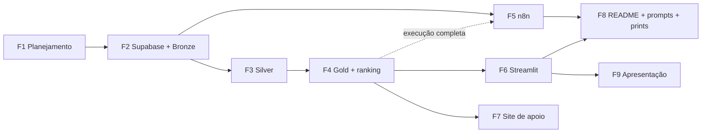

# Responsabilidades do squad — Radar de Expansão

> 📋 **PARA A REUNIÃO DO SQUAD — responsáveis a definir.** Versão 0.2 (26/11/2026).
> Este documento só lista as frentes e as tarefas. Quem assume cada uma é decidido na reunião, e o resultado é registrado aqui.

**Squad:** DROP Database — Squad #21001

**Membros:** José Martins (Junior) · Marco Pereira · Mario Castilho · Rodrigo Oliveira (Rodrigo Cesar Silva De Oliveira) · Rodrigo Vincensi

---

## 1. Objetivo e prazo

Entregar o **Radar de Expansão** para a **rede de academias**: um Lakehouse (bronze → silver → gold) no Supabase alimentado pelas
APIs do IBGE e do Banco Central, atualizado sozinho pelo n8n, com ranking de municípios num dashboard Streamlit publicado,
README completo, registro de prompts e apresentação de até 6 slides.

- **Início:** 18/11/2026 · **Entrega:** **20/12/2026**
- Cronograma de referência: [`prd.md`, seção 8](../prd.md#8-marcos-e-prazo).
- Documentos que todos leem antes de começar: [`prd.md`](../prd.md), [`spec.md`](../spec.md) e [`agents.md`](../agents.md).

## 2. Como o squad trabalha

**Branches e Pull Requests**
- Cada membro cria a **própria branch a partir do `main`**, com o próprio nome em minúsculas e hífen (ex.: `nome-sobrenome`).
  Ninguém commita direto no `main`.
- Antes de começar uma tarefa, atualize a sua branch com o `main`:

  ```powershell
  git switch main
  git pull
  git switch <sua-branch>          # na primeira vez: git switch -c <sua-branch>
  git merge main
  ```

- A entrega vai para o `main` **por Pull Request**, com **revisão e aprovação de pelo menos 1 outro membro**.
- Um PR por assunto, pequeno o bastante para ser revisado em 15 minutos. Na descrição: o que muda, como testar e a Issue relacionada.

**Commits**
- Padrão do [`agents.md`](../agents.md), seção 7: `tipo(escopo): descrição no imperativo`.
  Exemplo: `feat(ingestao): busca população do IBGE em lotes por ano`.
- Antes de cada commit: `git status` e `git diff --staged` revisados.

**Credenciais**
- **Nunca** commitar `.env`, senha, token ou string de conexão. Cada membro tem o próprio `.env` local, criado a partir do `.env.example`.
- A senha do banco é passada só por canal privado do squad, nunca por Issue, PR ou arquivo do repositório.

## 3. Frentes de trabalho

| # | Frente | Etapa do enunciado | Período | Responsável | Apoio |
|---|---|---|---|---|---|
| F1 | Coordenação, planejamento (prd, spec, agents), revisão de PRs e integração | 1 e 8 | 26/11 → 20/12 | _a definir_ | _a definir_ |
| F2 | Supabase + camada Bronze (ingestão IBGE e BCB, lotes, try/except) | 2 e 3 | 26/11 → 03/12 | _a definir_ | _a definir_ |
| F3 | Camada Silver (modelo estrela, limpeza, tipos, nulos) | 4 | 04/12 → 08/12 | _a definir_ | _a definir_ |
| F4 | Camada Gold + ranking (indicadores, ranking, contexto macro, semáforo) | 5 | 09/12 → 11/12 | _a definir_ | _a definir_ |
| F5 | Automação n8n (agenda semanal, checagem de período novo, export, print) | 6 | 06/12 → 14/12 | _a definir_ | _a definir_ |
| F6 | Dashboard Streamlit + deploy no Streamlit Cloud | 7 | 12/12 → 14/12 | _a definir_ | _a definir_ |
| F7 | Site de apoio (documentação + vitrine de dados) | extra | 15/12 → 17/12 | _a definir_ | _a definir_ |
| F8 | README, `prompts/` e prints | 8 | contínuo · fechamento 15/12 → 17/12 | _a definir_ | _a definir_ |
| F9 | Apresentação (até 6 slides) | entregável | 15/12 → 19/12 | _a definir_ | _a definir_ |

### Dependências



Quem espera quem: **bronze → silver → gold → Streamlit**. O n8n começa assim que a bronze existe (06/12) e fecha a execução
completa quando a gold estiver pronta. Enquanto espera, cada frente adianta o que não depende da anterior
(ex.: a silver escreve o SQL com uma amostra da bronze; o Streamlit monta o layout com dados de exemplo).

## 4. Detalhe de cada frente

Cada tarefa numerada (`F2.3`, `F4.2`...) é pensada para virar **uma Issue no GitHub**.

### F1 · Coordenação, planejamento e integração
**Responsável:** _a definir_ · **Apoio:** _a definir_

- **Entregáveis:** `prd.md`, `spec.md` e `agents.md` revisados; quadro de tarefas no GitHub Projects; revisão dos PRs; integração final no `main`.
- **Pronto quando:** os três documentos aprovados pelo squad até 28/11; todo PR revisado em até 24 h; em 19/12 o `main` roda do início ao fim (ingestão → gold → dashboard).
- **Depende de:** —. **Destrava:** todas as frentes.
- **Tarefas:**
  - [ ] F1.1 Revisar o `prd.md` com o squad (perguntas de negócio, critérios e pesos)
  - [ ] F1.2 Revisar o `spec.md` e decidir onde o n8n roda (`spec.md`, seção 8)
  - [ ] F1.3 Revisar o `agents.md` (regras, cabeçalho padrão, padrão de commit)
  - [ ] F1.4 Criar o quadro no GitHub Projects e abrir as Issues a partir deste documento
  - [ ] F1.5 Proteger o `main` (merge só por PR com 1 aprovação)
  - [ ] F1.6 Revisar os PRs ao longo do projeto (prazo de 24 h)
  - [ ] F1.7 Integração final: rodar o `main` do início ao fim em 19/12

### F2 · Supabase + camada Bronze
**Responsável:** _a definir_ · **Apoio:** _a definir_

- **Entregáveis:** projeto no Supabase com os schemas `bronze`, `silver` e `gold`; `sql/bronze/` (`api_resposta`, `execucao`, `vw_ultimo_periodo`);
  `src/ingestao/` (localidades, agregados do IBGE em lotes, séries do BCB, carga inicial).
- **Pronto quando:**
  - Supabase criado e acessível pelo Session pooler até 28/11;
  - `bronze.api_resposta` tem respostas de todos os recursos do `spec.md`, seção 2 (localidades, 6579, 4714, 5938, 7060, 10295, 9418, 9509, BCB 432 e 10813);
  - nenhuma chamada passa do limite de valores do IBGE (lotes por ano/UF);
  - rodar a carga duas vezes não duplica respostas;
  - erros de API ficam registrados em `bronze.execucao` sem derrubar o script.
- **Depende de:** F1 (`spec.md` aprovado). **Destrava:** F3 e F5.
- **Tarefas:**
  - [ ] F2.1 Criar o projeto no Supabase e os schemas `bronze`, `silver` e `gold`
  - [ ] F2.2 Testar a conexão pelo Session pooler a partir do `.env` (máquina local)
  - [ ] F2.3 DDL da bronze: `api_resposta`, `execucao` e `vw_ultimo_periodo`
  - [ ] F2.4 Módulo comum: conexão, chamada HTTP com timeout, 3 tentativas, validação de `content-type` e gravação na bronze com hash
  - [ ] F2.5 Ingestão de Localidades (regiões, estados, municípios `view=nivelado`)
  - [ ] F2.6 Ingestão da população estimada (6579) em lotes por ano
  - [ ] F2.7 Ingestão do Censo 2022 (4714 e 10295)
  - [ ] F2.8 Ingestão do PIB dos Municípios (5938) em lotes por ano
  - [ ] F2.9 Ingestão do IPCA (7060, índice geral)
  - [ ] F2.10 Ingestão do Cadastro Central de Empresas (9418 com CNAE 93.13-1 e 9509)
  - [ ] F2.11 Ingestão do BCB (432 e 10813) em janelas de até 10 anos
  - [ ] F2.12 Script de carga inicial que roda tudo e registra em `bronze.execucao`
  - [ ] F2.13 Teste de idempotência: rodar a carga duas vezes e conferir que nada duplica

### F3 · Camada Silver
**Responsável:** _a definir_ · **Apoio:** _a definir_

- **Entregáveis:** `sql/silver/` (dimensões `dim_regiao`, `dim_uf`, `dim_municipio`, `dim_calendario`, `dim_indicador`;
  fatos `fato_indicador_municipal` e `fato_indicador_macro`); execução em `src/transformacao/`.
- **Pronto quando:**
  - 5 regiões, 27 UFs e 5.571 municípios nas dimensões;
  - fatos sem duplicatas (chave primária) e com tipos corretos (número e data);
  - `"-"`, `"..."`, `"X"` e `".."` viram nulo com a flag certa;
  - 100% dos fatos casam com `dim_municipio`, e toda linha tem `bronze_id`.
- **Depende de:** F2. **Destrava:** F4.
- **Tarefas:**
  - [ ] F3.1 DDL das dimensões e dos fatos da silver
  - [ ] F3.2 Gerar `dim_calendario` (2000 a 2030)
  - [ ] F3.3 Carregar `dim_regiao`, `dim_uf` e `dim_municipio` a partir da bronze de localidades
  - [ ] F3.4 Preencher `dim_indicador` (catálogo de indicadores com origem e unidade)
  - [ ] F3.5 Achatar o JSON dos agregados do IBGE em `fato_indicador_municipal`, com as flags de valores especiais
  - [ ] F3.6 Carregar `fato_indicador_macro` (IPCA do IBGE + séries do BCB, sem datas futuras da Selic)
  - [ ] F3.7 Upsert e deduplicação (a versão mais nova vence)
  - [ ] F3.8 Checagens de qualidade: contagens, integridade com `dim_municipio`, `bronze_id` preenchido
  - [ ] F3.9 Script em `src/transformacao/` que executa a silver na ordem certa

### F4 · Camada Gold + ranking
**Responsável:** _a definir_ · **Apoio:** _a definir_

- **Entregáveis:** `sql/gold/` com `indicadores_municipio`, `ranking_expansao`, `ranking_criterio`, `contexto_macro` e `momento_expansao`.
- **Pronto quando:**
  - ranking com todos os municípios do universo (≥ 50 mil habitantes), notas entre 0 e 100 e soma dos pesos = 100%;
  - critérios e pesos iguais aos do `prd.md`;
  - `contexto_macro` mensal desde o início do histórico até o último mês disponível;
  - semáforo com recomendação e justificativa;
  - um número da gold é rastreado até a bronze numa demonstração.
- **Depende de:** F3. **Destrava:** F5 (execução completa), F6, F7 e F9.
- **Tarefas:**
  - [ ] F4.1 DDL da gold
  - [ ] F4.2 `indicadores_municipio`: população, crescimento desde o Censo 2022, PIB per capita e tendência, academias por 10 mil hab., renda e salário médio
  - [ ] F4.3 `ranking_criterio` com os critérios e pesos do `prd.md`
  - [ ] F4.4 `ranking_expansao`: universo, notas por percentil, nota final, posições no Brasil e na UF, flag de dados incompletos
  - [ ] F4.5 `contexto_macro` mensal (Selic, dólar, IPCA e variações em 12 meses)
  - [ ] F4.6 `momento_expansao`: semáforo de juros, inflação e câmbio + recomendação e justificativa
  - [ ] F4.7 Checagens: pesos somam 100%, notas entre 0 e 100, universo completo
  - [ ] F4.8 Demonstração de rastreio de um número da gold até a bronze

### F5 · Automação n8n
**Responsável:** _a definir_ · **Apoio:** _a definir_

- **Entregáveis:** `n8n/radar-expansao.json` (exportado sem credenciais) e print de uma execução bem-sucedida em `docs/img/`.
- **Pronto quando:**
  - agenda semanal ativa (segunda, 06:00);
  - o workflow compara com o último período salvo e busca só o que é novo;
  - uma execução de ponta a ponta termina com `sucesso` ou `sem_novidade` em `bronze.execucao`;
  - rodar duas vezes seguidas não duplica dados;
  - o JSON exportado não tem senha nem token.
- **Depende de:** F2 (bronze) e F4 (para a execução completa). Decisão pendente: onde o n8n roda (`spec.md`, seção 8).
- **Tarefas:**
  - [ ] F5.1 Subir ou acessar o n8n, conforme a decisão da F1.2
  - [ ] F5.2 Criar a credencial Postgres no n8n (Session pooler)
  - [ ] F5.3 Gatilho de agenda semanal (segunda, 06:00)
  - [ ] F5.4 Checagem de período novo do IBGE (`/periodos` × `bronze.vw_ultimo_periodo`)
  - [ ] F5.5 Busca incremental do BCB (última data salva − 30 dias; HTTP 404 = nada novo)
  - [ ] F5.6 Gravar na bronze e abrir/fechar o registro em `bronze.execucao`
  - [ ] F5.7 Disparar as transformações silver → gold
  - [ ] F5.8 Teste: duas execuções seguidas sem duplicar dados
  - [ ] F5.9 Exportar o workflow sem credenciais para `n8n/` e salvar o print da execução em `docs/img/`

### F6 · Dashboard Streamlit + deploy
**Responsável:** _a definir_ · **Apoio:** _a definir_

- **Entregáveis:** `src/app/` (páginas Ranking, Município, Momento econômico e Como o ranking é calculado); app publicado no Streamlit Cloud; prints em `docs/img/`.
- **Pronto quando:**
  - lê só a gold, com credenciais nos *Secrets* do Streamlit Cloud;
  - filtros por região e estado funcionando;
  - link público no README;
  - teste dos 30 segundos: alguém de fora do squad aponta as 5 cidades recomendadas e o motivo.
- **Depende de:** F4. **Destrava:** F8 (prints) e F9.
- **Tarefas:**
  - [ ] F6.1 Conexão com a gold (`.env` local, *Secrets* no Streamlit Cloud) com cache de consultas
  - [ ] F6.2 Página Ranking (filtros por região e UF, top N)
  - [ ] F6.3 Página Município (ficha com indicadores e notas)
  - [ ] F6.4 Página Momento econômico (Selic, dólar e IPCA no tempo + semáforo)
  - [ ] F6.5 Página Como o ranking é calculado (critérios, pesos e fontes)
  - [ ] F6.6 Deploy no Streamlit Cloud e link no README
  - [ ] F6.7 Teste dos 30 segundos com alguém de fora do squad
  - [ ] F6.8 Prints do dashboard em `docs/img/`

### F7 · Site de apoio
**Responsável:** _a definir_ · **Apoio:** _a definir_

- **Entregáveis:** `site/` publicado, com metodologia, arquitetura e vitrine de dados da gold.
- **Pronto quando:** publicado com link no README; números iguais aos do dashboard; sem nenhuma credencial no código.
- **Depende de:** F4. Decisão pendente: stack do site.
- **Tarefas:**
  - [ ] F7.1 Decidir a stack e a hospedagem do site
  - [ ] F7.2 Exportar os dados da gold para arquivos lidos pelo site
  - [ ] F7.3 Páginas de metodologia, arquitetura e vitrine de dados
  - [ ] F7.4 Publicar e colocar o link no README

### F8 · README, prompts e prints
**Responsável:** _a definir_ · **Apoio:** _a definir_

- **Entregáveis:** README com todas as seções do enunciado (problema, cliente, arquitetura, prints, link do app, como rodar,
  "Como eu usei IA neste projeto"); `prompts/` com registros de todas as etapas; prints em `docs/img/`.
- **Pronto quando:** nenhuma seção "a preencher" no README; pelo menos um registro de prompt por etapa; todos os links funcionando.
- **Regra para todos:** **cada membro registra os próprios prompts** em `prompts/`, no modelo de `prompts/README.md`, no mesmo PR da entrega.
- **Depende de:** todas as frentes.
- **Tarefas:**
  - [ ] F8.1 Acompanhar os registros de `prompts/` em cada PR (contínuo)
  - [ ] F8.2 Completar o README: arquitetura final, como rodar, link do app e prints
  - [ ] F8.3 Escrever a seção "Como eu usei IA neste projeto"
  - [ ] F8.4 Revisão final de seções e links

### F9 · Apresentação
**Responsável:** _a definir_ · **Apoio:** _a definir_

- **Entregáveis:** até 6 slides: o cliente e o problema · como o Radar resolve · arquitetura (bronze → silver → gold) ·
  o ranking final e o que ele recomenda · como a IA foi usada · próximos passos. Versão final em PDF em `docs/`.
- **Pronto quando:** no máximo 6 slides; números iguais aos do dashboard; ensaio completo feito até 19/12.
- **Depende de:** F4 e F6.
- **Tarefas:**
  - [ ] F9.1 Roteiro dos 6 slides
  - [ ] F9.2 Montar os slides com os números do dashboard
  - [ ] F9.3 Exportar o PDF para `docs/`
  - [ ] F9.4 Ensaio completo com o squad

## 5. Matriz por membro (preencher na reunião)

| Membro | Responsável por | Apoio em | Datas-chave |
|---|---|---|---|
| José Martins (Junior) | _a definir_ | _a definir_ | _a definir_ |
| Marco Pereira | _a definir_ | _a definir_ | _a definir_ |
| Mario Castilho | _a definir_ | _a definir_ | _a definir_ |
| Rodrigo Oliveira | _a definir_ | _a definir_ | _a definir_ |
| Rodrigo Vincensi | _a definir_ | _a definir_ | _a definir_ |

## 6. Rituais

- **Check-in curto, 2x por semana** (dias _a definir_ na reunião, 15 minutos): cada um diz o que fez, o que vai fazer e o que está travando.
- **Quadro de tarefas** no GitHub (Issues + Projects), com colunas *A fazer · Fazendo · Em revisão · Pronto*.
  Uma Issue por tarefa da seção 4, com o rótulo da frente (`f2-bronze`, `f3-silver`...) e o responsável. O PR cita a Issue que fecha.
- **Como pedir ajuda:** travou por mais de 2 horas? Comente na Issue chamando o responsável ou o apoio da frente e avise no grupo do squad.
  Ajuda pedida cedo custa menos que atraso descoberto tarde.
- **Se uma frente atrasar:** passou 1 dia do fim previsto e a frente seguinte está parada, o squad redistribui a parte pendente
  no próximo check-in (por exemplo, alguém assume em par com o responsável) e revê o cronograma.
  A folga de 18–19/12 é a reserva para imprevistos, não para trabalho novo.
- **Definição de pronto de qualquer entrega:** PR aprovado por pelo menos 1 membro · nenhum `.env` ou senha no PR ·
  `spec.md` ou `prd.md` atualizados se a entrega mudou modelo ou critério · prompts registrados em `prompts/`.
