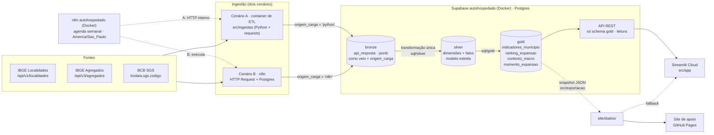
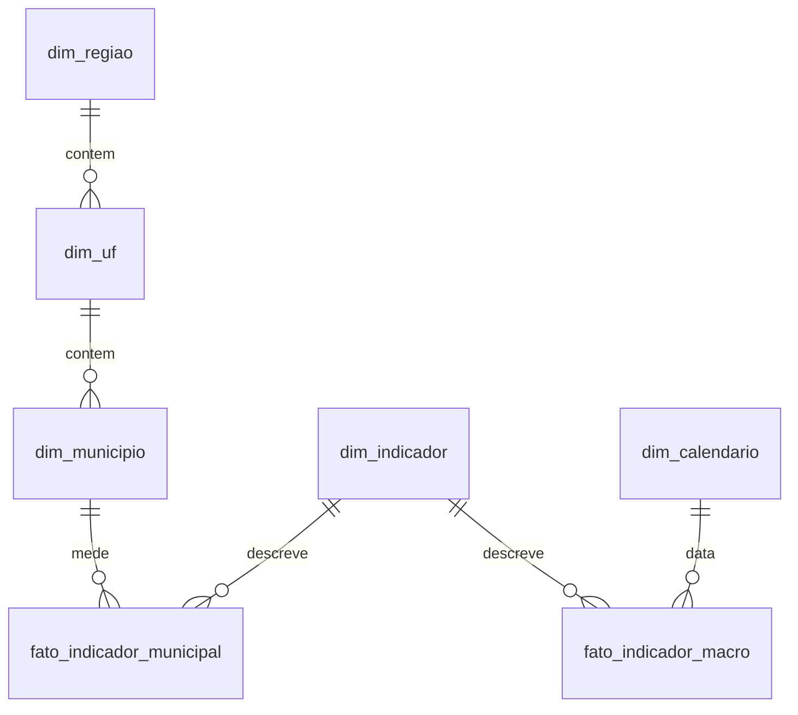
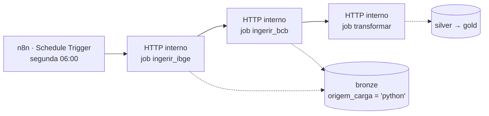
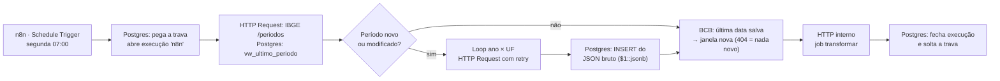

# spec.md — Especificação Técnica do Radar de Expansão

> **RASCUNHO v0.5 (26/11/2026)** — itens marcados com ⏳ dependem de decisão do squad.
> v0.5: silver implementada (seções 3.2 e 4); `dim_indicador` com agregado/variável/série; `dim_municipio` com regiões imediata e intermediária.
> v0.4: bronze implementada (seção 3.1 reflete o DDL de `sql/bronze/`); lote do IPCA por ano; app envia a chave anônima + token de leitura.
> v0.3: container de ETL disparado pelo n8n (cenário A); trava contra execução simultânea; fuso America/Sao_Paulo;
> dashboard lendo a gold pela API REST do Supabase com fallback em snapshot; conexão com `DB_SSLMODE` configurável; stack do site definida.
> v0.2: Supabase e n8n autohospedados via Docker; ingestão descrita em dois cenários (Python e n8n) com o mesmo contrato da bronze.
> Fonte da verdade técnica do projeto: toda mudança de modelo, endpoint ou regra é registrada aqui **antes** de ir para o código.

---

## 1. Visão geral

O Radar de Expansão é um Lakehouse em três camadas (bronze → silver → gold) num único banco Postgres (Supabase),
alimentado pelas APIs públicas do IBGE e do Banco Central, atualizado semanalmente pelo n8n e consumido por um dashboard Streamlit.
**Supabase e n8n são autohospedados via Docker** (Supabase num perfil enxuto: Postgres, API REST e Studio).
Todos os horários seguem o fuso **America/Sao_Paulo**.

A ingestão está especificada em **dois cenários**, construídos e comparados antes de o squad escolher um (seção 8):
**A — Python** (um container de ETL com os scripts do repositório chama as APIs; o n8n agenda e dispara por HTTP interno) e
**B — n8n** (o próprio workflow chama as APIs e grava o JSON bruto pelo nó Postgres).
Os dois gravam no **mesmo contrato da bronze**, marcando a origem em `origem_carga`; a transformação silver/gold é **um único caminho de código**.

O dashboard lê a gold pela **API REST do Supabase** (só o schema `gold`, papel somente leitura, RLS ligado) e, se a API não responder,
usa um **snapshot da gold versionado no repositório** (seção 9).



**Princípios**
1. **A bronze é o cofre:** guarda o JSON exatamente como a API devolveu. Nenhuma transformação na ingestão.
   As respostas (`bronze.api_resposta`) só recebem `INSERT`; apenas as tabelas de controle (`bronze.execucao`, `bronze.trava_carga`) são atualizadas.
2. **Rastreabilidade:** toda linha da silver guarda `bronze_id`; toda tabela da gold é recalculada a partir da silver. Dá para ir de um número do dashboard até a resposta original da API.
3. **Idempotência:** rodar a mesma carga duas vezes não duplica dado (hash na bronze, `UPSERT` na silver, recálculo completo na gold).
4. **Parâmetros no topo:** todo script tem um bloco `CONFIG` no início; credenciais só no `.env`.
5. **Fuso único:** colunas de controle em `timestamptz`; containers, banco e agenda do n8n em `America/Sao_Paulo`
   (datas das fontes, como `modificacao` do IBGE e `data` do BCB, já vêm no horário de Brasília).

---

## 2. Fontes e endpoints

### 2.1 IBGE — Localidades (`https://servicodados.ibge.gov.br/api/v1/localidades`)

| Recurso | Endpoint | Uso |
|---|---|---|
| Regiões | `/regioes` | `silver.dim_regiao` (5 linhas) |
| Estados | `/estados` | `silver.dim_uf` (27 linhas) |
| Municípios | `/municipios?view=nivelado` | `silver.dim_municipio` (5.571 linhas). JSON plano, sem aninhamento |

Armadilha conhecida: Boa Esperança do Norte-MT (`5101837`, município recente) vem com `microrregiao` nulo e não aparece em séries anteriores à sua criação.

### 2.2 IBGE — Agregados v3 (`https://servicodados.ibge.gov.br/api/v3/agregados`)

Padrão: `/{agregado}/periodos/{periodos}/variaveis/{variaveis}?localidades={nivel}[{ids}]&classificacao={cls}[{cats}]`

| Agregado | Indicador | Variáveis | Classificação | Períodos disponíveis | Nível |
|---|---|---|---|---|---|
| **6579** | População residente estimada (pessoas) | `9324` | — | 2001–2006, 2008, 2009, 2011–2021, 2024–2026 | N6 |
| **4714** | Censo 2022: população, área, densidade | `93`, `6318`, `614` | — | 2022 | N6 |
| **5938** | PIB dos Municípios a preços correntes (mil R$) | `37` | — | 2002–2023 | N6 |
| **7060** | IPCA (%) | `63` mensal, `2265` acumulado 12 meses | `315[7169]` (índice geral) | 202001–202610 | N1 |
| **10295** | Censo 2022: rendimento domiciliar per capita (R$) | `13431` média | `2[6794]\|86[95251]\|58[95253]` (totais) | 2022 | N6 |
| **9418** | Cadastro Central de Empresas por CNAE | `2585` nº de empresas | `12762[117856]` (CNAE 93.13-1) | 2022–2024 | N6 |
| **9509** | Cadastro Central de Empresas — total | `10143` salário médio mensal (R$) | — | 2022–2024 | N6 |

Endpoints auxiliares:
- `/{agregado}/metadados` — nomes, unidades, classificações e níveis territoriais.
- `/{agregado}/periodos` — lista de períodos com a data de `modificacao` → **base da carga incremental** (seção 6).

Armadilhas que o código precisa tratar:
- Valores chegam **sempre como texto**; o nome do município varia entre tabelas → usar só o código.
- População estimada **não tem 2007, 2010, 2022 e 2023**. 2022 vem do Censo (4714). 2023 é interpolado na gold (seção 5.2).
- PIB municipal sai com ~2 anos de atraso (último ano hoje: 2023) e o IBGE **revisa anos antigos** → a carga incremental precisa olhar `modificacao`, não só períodos novos.
- `periodos/all` devolve HTTP 500 → sempre listar os períodos explicitamente.
- Símbolos no lugar de número: `"-"` (zero absoluto), `"..."` (não disponível), `"X"` (sigilo estatístico), `".."` (não se aplica).

### 2.3 Validação do código CNAE das academias (chamada real em 26/11/2026)

Objetivo: confirmar o código da categoria **CNAE 93.13-1 — Atividades de condicionamento físico** na classificação 12762 do agregado 9418 e se há dado por município.

| Verificação | Chamada | Resultado |
|---|---|---|
| Categoria | `GET /api/v3/agregados/9418/metadados` | Classificação `12762` (CNAE 2.0, 1.067 categorias). **`117856` = "93.13-1 Atividades de condicionamento físico"** (nível 4 — classe). Grupo pai `117853` = "93.1 Atividades esportivas" |
| Níveis territoriais | idem | `N1`, `N2`, `N3`, **`N6` (município)** |
| Períodos | `GET /api/v3/agregados/9418/periodos` | `2022` (mod. 20/06/2024), `2023` (mod. 13/11/2025), `2024` (mod. 25/06/2026) |
| Dado por município | `GET .../9418/periodos/{ano}/variaveis/2585\|707?localidades=N6[all]&classificacao=12762[117856]` | HTTP 200 nos 3 anos, **5.570 municípios** por ano, ~1,3 MB, 11–22 s por chamada |

Conteúdo da resposta (variável 2585 — número de empresas):

| Ano | Municípios com número | Municípios com `"-"` (zero) | Total Brasil | São Paulo | Belo Horizonte | Brasília |
|---|---|---|---|---|---|---|
| 2022 | 4.417 | 1.153 | 53.711 | 3.746 | 834 | 1.181 |
| 2023 | 4.654 | 916 | 59.366 | 4.095 | 896 | 1.286 |
| 2024 | 4.816 | 754 | 65.346 | 4.500 | 1.008 | 1.329 |

**Conclusão:** o critério de concorrência é viável por município. Usar a **variável `2585` (empresas)**, que não tem sigilo.
A variável `707` (pessoal ocupado) **não serve** como critério: em 2024, 2.518 municípios vêm com `"X"` (sigilo).
Na silver, `"-"` vira nulo com flag `zero_absoluto`; na gold é lido como **0 academias**.

### 2.4 Banco Central — SGS (`https://api.bcb.gov.br/dados/serie/bcdata.sgs.{codigo}/dados`)

Parâmetros: `formato=json&dataInicial=dd/MM/aaaa[&dataFinal=dd/MM/aaaa]`. Resposta: `[{"data": "dd/MM/aaaa", "valor": "11.75"}]`.

| Série | Indicador | Periodicidade | Obrigatória |
|---|---|---|---|
| **432** | Meta da Selic (% a.a.) | diária | sim |
| **10813** | Dólar comercial — venda (R$) | dias úteis | sim |
| 433 | IPCA mensal (%) — conferência contra o IBGE 7060 | mensal | não (opcional) |

Armadilhas:
- Séries diárias: **datas obrigatórias** (sem datas → HTTP 406) e **janela máxima de 10 anos** por chamada.
- Data em formato ISO → HTTP 400. Período sem dado → **HTTP 404 = "nada novo"**, não é erro.
- A série 432 traz **datas futuras** (a meta vale até o próximo Copom).
- Código inexistente pode devolver HTTP 200 com HTML depois de ~30 s → validar `content-type: application/json` e usar timeout.
- Evitar `/ultimos/N` (limite de 20, ordem inconsistente entre séries).
- Para algumas URLs exatas o SGS devolve **HTTP 304 vazio**, mesmo sem cabeçalho condicional (visto na série 432 com
  `dataInicial=01/01/2025`). O código pede a mesma janela com a data final 1, 2 ou 3 dias depois; a silver descarta datas futuras.

---

## 3. Modelo de dados

Convenções (detalhe em `agents.md`): `snake_case`, português sem acento, chaves `*_id`, datas de controle `*_em` (`timestamptz`), dimensões `dim_*`, fatos `fato_*`.

### 3.1 Bronze — dado bruto

DDL implementado em `sql/bronze/` (rodar como `etl_radar` com `python -m src.transformacao.criar_estrutura`; idempotente):

| Arquivo | Objeto | Para quê |
|---|---|---|
| `01_execucao.sql` | `bronze.execucao` | log de cada carga: uma linha por recurso processado numa rodada |
| `02_api_resposta.sql` | `bronze.api_resposta` | o "cofre": uma linha por chamada bem-sucedida, JSON como veio; **só `INSERT`** (`UPDATE`, `DELETE` e `TRUNCATE` revogados até do dono) |
| `03_trava_carga.sql` | `bronze.trava_carga` | linha única que impede duas cargas ao mesmo tempo (seção 8.3) |
| `04_vw_ultimo_periodo.sql` | `bronze.vw_ultimo_periodo` | último período (IBGE) ou última data (BCB) salvos — base do incremental |

```sql
-- Uma linha por chamada bem-sucedida à API. Contrato único para os dois cenários (seção 8).
CREATE TABLE bronze.api_resposta (
    resposta_id        bigserial    PRIMARY KEY,
    origem_carga       text         NOT NULL CHECK (origem_carga IN ('python', 'n8n')),
    fonte              text         NOT NULL CHECK (fonte IN ('IBGE', 'BCB')),
    recurso            text         NOT NULL,      -- 'ibge_agregado_6579', 'ibge_municipios', 'bcb_sgs_432'...
    endpoint           text         NOT NULL,      -- caminho chamado, sem o host
    parametros         jsonb        NOT NULL,      -- períodos, variáveis, localidades, datas
    url                text         NOT NULL,      -- URL completa, para reproduzir a chamada
    lote               text         NOT NULL,      -- ano, ano-UF, janela de datas ou 'snapshot'
    modificacao_fonte  date,                       -- IBGE: `modificacao` do período (base do incremental)
    http_status        smallint     NOT NULL,
    payload            jsonb        NOT NULL,      -- resposta original, inteira
    -- md5 calculado pelo Postgres sobre o jsonb (forma canônica): igual nos dois cenários
    payload_hash       text         GENERATED ALWAYS AS (md5(payload::text)) STORED,
    execucao_id        bigint       REFERENCES bronze.execucao (execucao_id),
    ingerido_em        timestamptz  NOT NULL DEFAULT now(),
    CONSTRAINT uq_api_resposta UNIQUE (origem_carga, recurso, lote, payload_hash)
);

-- Log de cada carga: uma linha por recurso processado numa rodada.
CREATE TABLE bronze.execucao (
    execucao_id      bigserial    PRIMARY KEY,
    rodada_id        uuid         NOT NULL,      -- agrupa os recursos de uma mesma carga
    origem_carga     text         NOT NULL CHECK (origem_carga IN ('python', 'n8n')),
    disparado_por    text         NOT NULL,      -- 'manual' | 'agenda_n8n'
    modo             text         NOT NULL CHECK (modo IN ('inicial', 'incremental')),
    recurso          text         NOT NULL,      -- 'rodada' = registro de rodada ignorada pela trava
    iniciado_em      timestamptz  NOT NULL DEFAULT now(),
    finalizado_em    timestamptz,
    status           text         NOT NULL DEFAULT 'em_andamento',
                     -- 'em_andamento' | 'sucesso' | 'sem_novidade' | 'erro' | 'ignorada_trava'
    chamadas_ok      integer      NOT NULL DEFAULT 0,   -- inclui o 404 "nada novo" do BCB
    chamadas_erro    integer      NOT NULL DEFAULT 0,   -- falharam depois de todas as tentativas
    respostas_novas  integer      NOT NULL DEFAULT 0,   -- gravadas (repetidas não contam)
    mensagem         text
);

-- Último período salvo por processo, recurso e lote.
CREATE VIEW bronze.vw_ultimo_periodo AS
SELECT origem_carga, recurso, lote,
       max(modificacao_fonte) AS modificacao_fonte,                 -- IBGE
       max(CASE WHEN fonte = 'BCB' THEN (SELECT max(to_date(e ->> 'data', 'DD/MM/YYYY'))
                                         FROM jsonb_array_elements(payload) e) END) AS ultima_data,  -- BCB
       max(ingerido_em) AS ingerido_em, count(*) AS respostas
FROM bronze.api_resposta
GROUP BY origem_carga, recurso, lote;
```

Regras de gravação: status da execução = `sucesso` se gravou ao menos uma resposta nova, `sem_novidade` se todas as respostas
já existiam (mesmo hash) ou a fonte respondeu "nada novo", `erro` se alguma chamada falhou depois das tentativas.
Cada cenário filtra a própria `origem_carga` na view, para um não "esconder" o período novo do outro.

### 3.2 Silver — modelo estrela

DDL implementado em `sql/silver/` (rodar como `etl_radar` com `python -m src.transformacao.criar_estrutura`; idempotente):

| Arquivo | Conteúdo |
|---|---|
| `01_dimensoes.sql` | `dim_regiao`, `dim_uf`, `dim_municipio`, `dim_calendario` (gerada, 2000–2030) e `dim_indicador` (catálogo com a origem de cada indicador) |
| `02_fatos.sql` | `fato_indicador_municipal` e `fato_indicador_macro` |
| `03_funcoes_apoio.sql` | `silver.valor_numerico()`, `silver.flag_valor()` e `silver.bronze_vigente(origem)` |
| `04_atualizar_silver.sql` | `silver.atualizar(origem)`: a transformação bronze → silver (seção 4) |
| `05_testes_qualidade.sql` | `silver.vw_testes_qualidade`: testes do "pronto quando" (esperado × obtido) |



```sql
CREATE TABLE silver.dim_regiao (
    regiao_id smallint PRIMARY KEY, regiao_sigla char(2) NOT NULL UNIQUE, regiao_nome text NOT NULL,
    bronze_id bigint NOT NULL, atualizado_em timestamptz NOT NULL DEFAULT now()
);

CREATE TABLE silver.dim_uf (
    uf_id smallint PRIMARY KEY, uf_sigla char(2) NOT NULL UNIQUE, uf_nome text NOT NULL,
    regiao_id smallint NOT NULL REFERENCES silver.dim_regiao,
    bronze_id bigint NOT NULL, atualizado_em timestamptz NOT NULL DEFAULT now()
);

CREATE TABLE silver.dim_municipio (
    municipio_id              integer  PRIMARY KEY,          -- 7 dígitos (código IBGE)
    municipio_nome            text     NOT NULL,
    uf_id                     smallint NOT NULL REFERENCES silver.dim_uf,
    regiao_id                 smallint NOT NULL REFERENCES silver.dim_regiao,
    regiao_intermediaria_id   integer,  regiao_intermediaria_nome text,
    regiao_imediata_id        integer,  regiao_imediata_nome      text,   -- usada pelo prd
    mesorregiao_id            integer,  mesorregiao_nome          text,
    microrregiao_id           integer,  microrregiao_nome         text,   -- pode ser nulo
    bronze_id                 bigint   NOT NULL,
    atualizado_em             timestamptz NOT NULL DEFAULT now()
);

CREATE TABLE silver.dim_calendario (
    data date PRIMARY KEY, ano smallint NOT NULL, trimestre smallint NOT NULL, mes smallint NOT NULL,
    ano_mes integer NOT NULL, nome_mes text NOT NULL, dia_semana smallint NOT NULL, eh_fim_de_semana boolean NOT NULL
);

CREATE TABLE silver.dim_indicador (
    indicador_id   text PRIMARY KEY,      -- 'populacao_estimada', 'pib', 'academias_qtd', 'selic_meta'...
    indicador_nome text NOT NULL,
    fonte          text NOT NULL,         -- 'IBGE' | 'BCB'
    agregado       integer,               -- IBGE: tabela    } a transformação usa estas três
    variavel       integer,               -- IBGE: variável  } colunas para ligar a resposta
    serie_bcb      integer,               -- BCB: série SGS  } da bronze ao indicador
    codigo_origem  text NOT NULL,         -- forma legível: '9418/2585 · 12762[117856]'
    unidade        text NOT NULL,         -- 'pessoas', 'mil R$', 'R$', '%', '% a.a.', 'unidades'
    periodicidade  text NOT NULL,         -- 'anual' | 'decenal' | 'mensal' | 'diaria'
    nivel          text NOT NULL,         -- 'municipal' | 'macro'
    descricao      text,
    UNIQUE (agregado, variavel), UNIQUE (serie_bcb)
);

CREATE TABLE silver.fato_indicador_municipal (
    municipio_id  integer  NOT NULL REFERENCES silver.dim_municipio,
    indicador_id  text     NOT NULL REFERENCES silver.dim_indicador,
    ano           smallint NOT NULL,
    valor         numeric,                -- nulo quando a fonte mandou símbolo
    flag_valor    text     NOT NULL,      -- 'ok' | 'zero_absoluto' | 'nao_disponivel' | 'sigilo' | 'nao_se_aplica' | 'invalido'
    bronze_id     bigint   NOT NULL,
    atualizado_em timestamptz NOT NULL DEFAULT now(),
    PRIMARY KEY (municipio_id, indicador_id, ano)
);

CREATE TABLE silver.fato_indicador_macro (
    indicador_id  text NOT NULL REFERENCES silver.dim_indicador,
    data          date NOT NULL REFERENCES silver.dim_calendario,   -- mensal: 1º dia do mês
    valor         numeric,
    flag_valor    text NOT NULL,
    bronze_id     bigint NOT NULL,
    atualizado_em timestamptz NOT NULL DEFAULT now(),
    PRIMARY KEY (indicador_id, data)
);
```

`bronze_id` existe em toda linha que vem da bronze (regiões, UFs, municípios e fatos). `dim_calendario` e `dim_indicador`
são geradas pelo próprio DDL e não têm origem na bronze.

Indicadores em `dim_indicador`:

| indicador_id | Origem | Nível | Unidade |
|---|---|---|---|
| `populacao_estimada` | IBGE 6579/9324 | municipal | pessoas |
| `populacao_censo`, `area_km2`, `densidade_demografica` | IBGE 4714/93, 6318, 614 | municipal | pessoas, km², hab/km² |
| `pib` | IBGE 5938/37 | municipal | mil R$ |
| `vab_total`, `vab_agropecuaria`, `vab_industria`, `vab_servicos`, `vab_administracao_publica`, `impostos_liquidos` | IBGE 5938/498, 513, 517, 6575, 525, 543 (até 2021) | municipal | mil R$ |
| `renda_dom_per_capita` | IBGE 10295/13431 | municipal | R$ |
| `academias_qtd` | IBGE 9418/2585 · CNAE 93.13-1 | municipal | unidades |
| `salario_medio` | IBGE 9509/10143 | municipal | R$ |
| `ipca_mensal`, `ipca_12m` | IBGE 7060/63 e 2265 · 315[7169] | macro | % |
| `selic_meta` | BCB SGS 432 | macro | % a.a. |
| `dolar_venda` | BCB SGS 10813 | macro | R$ |
| `ipca_mensal_bcb` | BCB SGS 433 (conferência do IPCA do IBGE) | macro | % |

### 3.3 Gold — tabelas de consumo

Cada tabela responde a perguntas do `prd.md` (coluna "Pergunta").

```sql
CREATE SCHEMA IF NOT EXISTS gold;

-- P1, P3, P4: uma linha por município com os indicadores do "fator onde".
CREATE TABLE gold.indicadores_municipio (
    municipio_id              integer  PRIMARY KEY,
    municipio_nome            text     NOT NULL,
    uf_sigla                  char(2)  NOT NULL,
    regiao_sigla              char(2)  NOT NULL,
    populacao                 integer,           -- estimativa mais recente
    populacao_ano             smallint,
    populacao_censo_2022      integer,
    crescimento_pop_aa        numeric(7,4),      -- CAGR Censo 2022 → último ano (fração: 0.0123 = 1,23% a.a.)
    pib_mil_reais             numeric,           -- PIB do último ano disponível
    pib_ano                   smallint,
    pib_per_capita            numeric(12,2),     -- R$ por habitante, mesmo ano do PIB
    pib_per_capita_tendencia  numeric(7,4),      -- CAGR do PIB per capita (5 anos até pib_ano)
    renda_dom_per_capita      numeric(10,2),     -- R$/mês, Censo 2022
    academias_qtd             integer,           -- empresas CNAE 93.13-1, último ano
    academias_ano             smallint,
    academias_por_10mil_hab   numeric(8,3),
    salario_medio             numeric(10,2),     -- R$/mês, Cadastro Central de Empresas
    atualizado_em             timestamptz NOT NULL DEFAULT now()
);

-- P2, P5, P8: ranking do cliente com a nota de cada critério (0–100) e a nota final.
CREATE TABLE gold.ranking_expansao (
    municipio_id              integer  PRIMARY KEY,
    municipio_nome            text     NOT NULL,
    uf_sigla                  char(2)  NOT NULL,
    regiao_sigla              char(2)  NOT NULL,
    populacao                 integer  NOT NULL,
    nota_mercado              numeric(5,2),
    nota_poder_compra         numeric(5,2),
    nota_espaco_competitivo   numeric(5,2),
    nota_crescimento          numeric(5,2),
    nota_riqueza              numeric(5,2),
    nota_mercado_formal       numeric(5,2),
    nota_final                numeric(5,2) NOT NULL,
    posicao_brasil            integer  NOT NULL,
    posicao_uf                integer  NOT NULL,
    dados_incompletos         boolean  NOT NULL DEFAULT false,  -- algum critério recebeu nota neutra
    versao_pesos              text     NOT NULL,
    calculado_em              timestamptz NOT NULL DEFAULT now()
);

-- P8: critérios e pesos usados (alimenta a explicação do ranking no dashboard).
CREATE TABLE gold.ranking_criterio (
    criterio      text     PRIMARY KEY,   -- 'mercado', 'poder_compra', ...
    descricao     text     NOT NULL,
    fonte         text     NOT NULL,
    peso          numeric(4,3) NOT NULL,  -- soma = 1.000
    sentido       text     NOT NULL,      -- 'maior_melhor' | 'menor_melhor'
    versao_pesos  text     NOT NULL
);

-- P6, P7: evolução mensal do cenário econômico.
CREATE TABLE gold.contexto_macro (
    mes                  date PRIMARY KEY,     -- primeiro dia do mês
    selic_meta           numeric(6,2),         -- % a.a., valor vigente no último dia do mês
    selic_var_12m_pp     numeric(6,2),         -- variação em pontos percentuais contra 12 meses antes
    dolar_medio          numeric(8,4),         -- R$, média dos dias úteis do mês
    dolar_var_12m_pct    numeric(7,2),
    ipca_mensal          numeric(6,2),         -- %
    ipca_12m             numeric(6,2),         -- %
    atualizado_em        timestamptz NOT NULL DEFAULT now()
);

-- P7: "fator quando" — expandir agora, com cautela ou esperar (uma linha por mês).
CREATE TABLE gold.momento_expansao (
    mes              date PRIMARY KEY,
    sinal_juros      text NOT NULL,   -- 'verde' | 'amarelo' | 'vermelho'
    sinal_inflacao   text NOT NULL,
    sinal_cambio     text NOT NULL,
    pontuacao        smallint NOT NULL,   -- verde = +1, amarelo = 0, vermelho = -1
    recomendacao     text NOT NULL,   -- 'Expandir agora' | 'Expandir com cautela' | 'Esperar'
    justificativa    text NOT NULL,   -- frase pronta para o dashboard
    atualizado_em    timestamptz NOT NULL DEFAULT now()
);
```

Relacionamentos lógicos: `gold.*.municipio_id` → `silver.dim_municipio`; `gold.contexto_macro.mes` → `silver.dim_calendario`.

### 3.4 Papéis e permissões

| Papel | Uso | Permissões |
|---|---|---|
| `etl_radar` | scripts de ingestão/transformação e credencial Postgres do n8n | `LOGIN`; leitura e escrita em `bronze`, `silver` e `gold`; sem superusuário. Na bronze, só `INSERT` e `SELECT` |
| `web_leitor` | API REST lida pelo dashboard | `NOLOGIN`; `USAGE` no schema `gold` e `SELECT` nas tabelas da gold; nada em `bronze` e `silver` |
| `anon` | acesso anônimo da API | nenhum acesso à gold |

```sql
CREATE ROLE web_leitor NOLOGIN;
GRANT USAGE ON SCHEMA gold TO web_leitor;
GRANT SELECT ON ALL TABLES IN SCHEMA gold TO web_leitor;
ALTER DEFAULT PRIVILEGES FOR ROLE etl_radar IN SCHEMA gold GRANT SELECT ON TABLES TO web_leitor;
GRANT web_leitor TO authenticator;          -- papel que a API REST assume ao validar o token

-- RLS como defesa extra (repetir para cada tabela da gold)
ALTER TABLE gold.ranking_expansao ENABLE ROW LEVEL SECURITY;
CREATE POLICY leitura_web ON gold.ranking_expansao FOR SELECT TO web_leitor USING (true);
```

A API REST expõe **somente** o schema `gold`; `bronze`, `silver` e `public` não aparecem nela.
Script completo e idempotente (schemas, papéis, permissões e RLS em todas as tabelas da gold): `infra/sql/00_schemas_roles.sql`.

---

## 4. Regras bronze → silver

1. **Fonte única por lote:** para cada `(recurso, lote)` usa-se só a resposta mais recente da bronze (`DISTINCT ON ... ORDER BY ingerido_em DESC`).
   O parâmetro `ORIGEM_CARGA_SILVER` (`'python'`, `'n8n'` ou `'qualquer'`, padrão `'qualquer'`) restringe a leitura a um cenário,
   para comparar as duas ingestões; silver e gold não mudam de estrutura conforme o cenário.
2. **Achatar o JSON do IBGE:** `payload[] → resultados[] → classificacoes / series[] → serie{periodo: valor}`. Cada linha da silver = localidade + período + variável (+ categoria) + valor.
3. **Períodos:** `"2024"` → `ano = 2024`; `"202610"` → `data = 2026-10-01`. BCB: `"dd/MM/aaaa"` → `date`.
4. **Tipos:** texto → `numeric` (o IBGE e o BCB usam ponto decimal). Códigos de localidade → `integer`.
5. **Ausentes:** `"-"` → nulo + `zero_absoluto`; `"..."` → nulo + `nao_disponivel`; `"X"` → nulo + `sigilo`; `".."` → nulo + `nao_se_aplica`.
6. **Códigos padronizados:** `municipio_id` com 7 dígitos; `uf_id = municipio_id / 100000`; `regiao_id = uf_id / 10`. Todo fato precisa casar com `dim_municipio` (checagem de integridade ao fim da carga).
7. **Duplicados:** chave primária + `INSERT ... ON CONFLICT DO UPDATE` → a versão mais nova vence (o IBGE revisa o PIB de anos anteriores).
8. **Selic com datas futuras:** a silver guarda só `data <= current_date`; o futuro continua na bronze.
9. **Unidades preservadas:** PIB fica em mil R$ na silver (unidade em `dim_indicador`); conversões acontecem na gold.
10. **Rastreio:** toda linha leva `bronze_id`.

**Implementação (um único caminho para os cenários A e B).** As regras acima estão na função `silver.atualizar(origem)`
(`sql/silver/04_atualizar_silver.sql`). O cenário A a chama por `python -m src.transformacao.executar`; o cenário B chama
o mesmo job ou faz `SELECT * FROM silver.atualizar()` pelo nó Postgres. A função:

- materializa a resposta vigente de cada `(recurso, lote)` (`silver.bronze_vigente`);
- liga cada variável do IBGE ao indicador por `parametros->>'agregado'` + `id` da variável, e cada série do BCB por
  `parametros->>'serie'` — **por isso os dois cenários gravam esses campos em `parametros`**;
- usa `jsonb_array_elements` / `jsonb_each_text` para achatar o JSON; `DISTINCT ON` + `ON CONFLICT DO UPDATE` para não
  duplicar; só reescreve uma linha quando valor, flag ou `bronze_id` mudaram (rodar de novo sem bronze nova grava 0 linhas);
- devolve as linhas gravadas por tabela.

**Testes de qualidade** (`silver.vw_testes_qualidade`, rodados pelo `executar.py`, que termina com erro se algum falhar):
5 regiões · 27 UFs · 5.571 municípios · nenhum município sem região imediata · nenhum município citado na bronze sem par
na `dim_municipio` · todo indicador com linhas · nenhum valor com formato inválido · coerência entre valor nulo e flag ·
toda linha rastreável até a bronze · nenhuma data futura nos fatos macro · IPCA do IBGE igual ao do BCB em todos os meses.

## 5. Regras silver → gold

### 5.1 `gold.contexto_macro` e `gold.momento_expansao`
- Selic do mês = meta vigente no último dia do mês; dólar do mês = média dos dias úteis; IPCA = variáveis 63 e 2265 do IBGE.
- Variações de 12 meses: Selic em pontos percentuais; dólar em %.
- Semáforo (limiares no `CONFIG` do script, valores iniciais a validar com o squad ⏳):

| Sinal | Verde (+1) | Amarelo (0) | Vermelho (−1) |
|---|---|---|---|
| Juros | Selic caiu ≥ 0,5 p.p. em 12 meses | variação entre −0,5 e +0,5 p.p. | Selic subiu > 0,5 p.p. |
| Inflação | IPCA 12m ≤ 4,5% e desacelerando (vs. 3 meses antes) | só uma das duas condições | IPCA 12m > 4,5% e acelerando |
| Câmbio | dólar ≤ 12 meses antes | alta de até 10% | alta > 10% |

  Pontuação = soma dos três sinais: **≥ +2 → "Expandir agora"**, **0 a +1 → "Expandir com cautela"**, **≤ −1 → "Esperar"**.

### 5.2 `gold.indicadores_municipio`
- **População:** estimativa mais recente do 6579. População de 2022 = Censo (4714). População de 2023 (inexistente na fonte) = interpolação geométrica `√(pop2022 × pop2024)`, usada só para o PIB per capita de 2023.
- **Crescimento:** `(pop_último_ano / pop_censo_2022)^(1/(último_ano − 2022)) − 1`.
  Não usar 2021 como base: as estimativas até 2021 eram projetadas a partir do Censo 2010 e ficaram acima do Censo 2022
  (Brasil: 213,3 mi estimados em 2021 × 203,1 mi recenseados em 2022), o que distorceria o crescimento.
- **PIB per capita** = `pib_mil_reais × 1000 / populacao` do mesmo ano. **Tendência** = CAGR do PIB per capita nos 5 anos até o último ano do PIB.
  Como o ranking usa percentil, deflacionar pelo IPCA não muda a ordem (a inflação é a mesma para todos os municípios).
- **Academias por 10 mil hab.** = `academias_qtd / populacao_do_mesmo_ano × 10000`; `zero_absoluto` = 0 academias.

### 5.3 `gold.ranking_expansao`
- **Universo:** municípios com população estimada ≥ 50 mil (687 municípios na estimativa de 2026). Limite no `CONFIG`.
- **Nota de cada critério:** percentil no universo × 100 (`percent_rank()`), invertido quando "menor é melhor".
- **Nota final:** soma ponderada das notas pelos pesos do `prd.md` (gravados em `gold.ranking_criterio`).
- **Dado faltante:** o critério recebe nota neutra 50 e `dados_incompletos = true`.
- **Posições:** `posicao_brasil` e `posicao_uf` por `nota_final` decrescente.
- A gold é **recalculada inteira** a cada execução (são poucos milhares de linhas).

---

## 6. Limite da API do IBGE e estratégia de lotes

O IBGE não documenta o limite, mas nos testes ele fica em **≈ 100 mil valores por chamada**
(valores = períodos × variáveis × localidades × categorias). Acima disso a API devolve HTTP 500 genérico.

Regra do código (`CONFIG: LIMITE_VALORES_POR_CHAMADA = 50_000`, metade do limite como margem):
1. Estimar o tamanho da chamada antes de fazer.
2. Se passar do limite: dividir **por ano**; se um ano ainda passar, dividir **por UF** (`N6[N3[uf]]`).
3. Cada lote é uma linha na bronze (`lote = '2024'` ou `lote = '2024-MG'`).
4. **No cenário B (n8n)** os agregados municipais são pedidos **sempre por ano × UF** (`N6[N3[uf]]`, 27 chamadas por ano):
   respostas menores evitam estourar a memória do n8n, que segura os itens em RAM. O JSON é gravado inteiro, sem ser "explodido" em itens.

| Agregado | Lote padrão | Valores por chamada |
|---|---|---|
| 6579 população | 1 ano × N6[all] | ≈ 5.570 |
| 5938 PIB | 1 ano × N6[all] | ≈ 5.570 |
| 9418 CNAE 93.13-1 | 1 ano × N6[all] × 1 categoria | ≈ 5.570 (11–22 s) |
| 9509 salário médio | 1 ano × N6[all] | ≈ 5.570 |
| 4714 / 10295 Censo | carga única × N6[all] | ≤ 16.710 |
| 7060 IPCA | todos os meses × N1 | < 200 |

Boas práticas de chamada: timeout de 60 s (120 s para o 9418), 3 tentativas com espera crescente (2 s, 4 s, 8 s),
validar `content-type: application/json`, `User-Agent` próprio do projeto e `try/except` com registro em `bronze.execucao`.

## 7. Carga de dados novos (incremental)

| Fonte | Carga inicial | Carga incremental (semanal) |
|---|---|---|
| Localidades | 1 chamada por recurso | recarga completa (barata); a silver atualiza por `UPSERT` |
| Agregados anuais (6579, 5938, 9418, 9509) | 1 chamada por ano | `GET /{agregado}/periodos` → compara `id` e `modificacao` com `bronze.vw_ultimo_periodo` (filtrada pela própria `origem_carga`) → baixa só período **novo** ou **modificado** |
| Censo (4714, 10295) | carga única | só se `/periodos` mostrar `modificacao` mais nova |
| IPCA (7060) | um lote por ano (meses AAAAMM agrupados) | mesma regra dos anuais: o lote do ano é baixado de novo quando um mês dele é novo ou modificado (maior `modificacao` dos meses) |
| BCB diárias (432, 10813) | janelas de até 10 anos desde `DATA_INICIO` (CONFIG, proposta: 01/01/2015) | `dataInicial = última data salva − 30 dias`, sem `dataFinal`; HTTP 404 = nada novo |

Depois de gravar na bronze, a execução roda `silver` → `gold` só se houve resposta nova; senão registra `status = 'sem_novidade'`.
As regras desta seção e da seção 6 (lotes, limites, janelas, retry) valem **igualmente para os dois cenários** da seção 8.

## 8. Ingestão e automação: dois cenários

O n8n roda **autohospedado via Docker** e agenda a atualização semanal no fuso **America/Sao_Paulo**.
A diferença entre os cenários é **quem chama as APIs e grava na bronze**. Os dois são construídos na trilha de desenvolvimento e
comparados; o squad escolhe um para a entrega (⏳).

**O que é comum aos dois**
- Mesmo contrato da bronze: `bronze.api_resposta` + `bronze.execucao`, com `origem_carga = 'python'` ou `'n8n'` (seção 3.1).
- Mesmas regras de lote, limite do IBGE, janelas do BCB, retry e carga incremental (seções 6 e 7).
- **Transformação num único caminho de código:** as regras da silver e da gold ficam em SQL versionado (`sql/silver/`, `sql/gold/`)
  e são executadas sempre pelo mesmo programa, `src/transformacao/executar.py`. Nos dois cenários o n8n o aciona pelo job
  `transformar` do container de ETL (seção 8.1). Não existe uma segunda versão das regras dentro do n8n.
- **Trava contra execução simultânea** (seção 8.3) e agendas em horários diferentes.

### 8.1 Cenário A — container de ETL em Python (o n8n agenda e dispara)

Um container de ETL (imagem Python fixa, com o `requirements.txt` instalado e o código deste repositório montado só para leitura)
fica na mesma rede Docker interna do n8n e do banco. Ele **não publica porta** nem fica exposto fora do servidor.
Um disparador HTTP interno executa apenas **jobs fixos** — nenhum comando livre vem da requisição:

| Job | Executa |
|---|---|
| `ingerir_ibge` | `python -m src.ingestao.carga_incremental --fonte ibge --disparado-por agenda_n8n` |
| `ingerir_bcb` | `python -m src.ingestao.carga_incremental --fonte bcb --disparado-por agenda_n8n` |
| `transformar` | `python -m src.transformacao.executar` |

O n8n chama cada job com um nó *HTTP Request* (`POST` interno, com um token secreto num header guardado como credencial do n8n).
A resposta é síncrona e traz o código de retorno do script, então o n8n marca erro se o script falhar.



- `src/ingestao/` faz as chamadas com `requests` (timeout, 3 tentativas, validação de `content-type`) e grava na bronze.
- Carga inicial (milhares de municípios, chamadas de até 22 s): roda à mão no container, fora do disparo síncrono do n8n.
  A incremental semanal cabe no disparo (timeout do nó HTTP de ~15 min).
- No servidor o container usa `TZ=America/Sao_Paulo` e o papel `etl_radar`.

### 8.2 Cenário B — ingestão no próprio n8n



- Nós *HTTP Request* (com *Retry On Fail*, timeout e espera entre tentativas), *Loop Over Items* para os lotes **ano × UF**
  (seção 6, item 4), nó *Code* só para montar URLs e parâmetros, nó *Postgres* para ler o último período e gravar o JSON
  inteiro em `jsonb` **sem transformar** — uma linha por chamada.
- Memória do n8n: não "explodir" o JSON em milhares de itens; histórico de execuções com limpeza automática (7 dias),
  sem guardar o conteúdo das execuções bem-sucedidas que carregam JSON grande.
- Carga inicial: o mesmo workflow com gatilho manual e `modo = 'inicial'`, rodando por agregado.
- Credencial Postgres do n8n com o papel `etl_radar` (ou um papel ainda mais restrito: só `INSERT`/`SELECT` na bronze).

### 8.3 Convivência dos cenários: trava e agenda

- **Agendas diferentes:** cenário A na segunda às 06:00; cenário B na segunda às 07:00 (ou só manual, para demonstração).
- **Trava de carga:** toda execução, nos dois cenários, começa tentando pegar a trava e só segue se conseguir. Se não conseguir,
  registra `status = 'ignorada_trava'` em `bronze.execucao` e termina sem chamar as APIs. A trava vale entre processos e
  conexões diferentes (Python e nó Postgres do n8n) e expira sozinha se um processo morrer no meio.

```sql
CREATE TABLE bronze.trava_carga (
    trava_id      smallint PRIMARY KEY DEFAULT 1 CHECK (trava_id = 1),  -- uma única linha
    em_uso_por    text,                                                 -- 'python' | 'n8n' | nulo = livre
    rodada_id     uuid,
    desde         timestamptz
);
INSERT INTO bronze.trava_carga (trava_id) VALUES (1);

-- Pegar a trava (devolve 1 linha se conseguiu; 0 se outro processo está rodando)
UPDATE bronze.trava_carga
SET em_uso_por = :origem_carga, rodada_id = :rodada_id, desde = now()
WHERE trava_id = 1
  AND (em_uso_por IS NULL OR desde < now() - interval '2 hours')   -- expira trava esquecida
RETURNING trava_id;

-- Soltar a trava (no fim, inclusive no caminho de erro)
UPDATE bronze.trava_carga SET em_uso_por = NULL, rodada_id = NULL, desde = NULL
WHERE trava_id = 1 AND rodada_id = :rodada_id;
```

### 8.4 Prós e contras

| | Cenário A — container de ETL em Python | Cenário B — n8n |
|---|---|---|
| **Onde fica a lógica** | Código Python versionado em `src/ingestao/`, com bloco `CONFIG` | Nós do workflow, exportados em `n8n/*.json` |
| **Prós** | Fácil de revisar em PR e de testar localmente · reaproveita o que o curso ensinou (`requests`, `pandas`) · carga inicial pesada sem limite de memória do n8n · uma só implementação para carga inicial e incremental · imagem oficial do n8n intacta | Automação inteira visível num só fluxo (bom para demonstrar e para o print da execução) · retry e agendamento nativos · qualquer membro acompanha a execução pela interface · um container a menos na ingestão |
| **Contras** | Um container a mais para manter (build quando mudar o `requirements.txt`) · logs em dois lugares (n8n e script) · o n8n vira só agendador | Lógica de lotes e URLs espalhada em nós e JavaScript · revisão de PR difícil (JSON exportado) · lotes por UF multiplicam as chamadas (27 por ano) · memória do n8n exige cuidado · atenção redobrada para não exportar credenciais |
| **Risco principal** | Dependências do Python no servidor | Workflow grande e frágil de manter |

### 8.5 Como comparar os dois

Os lotes não são iguais (A pede por ano; B, por ano × UF), então a comparação é feita **depois da silver**, que é igual para os dois:

1. Rodar os dois cenários sobre os mesmos recursos e períodos.
2. Gerar a silver com `ORIGEM_CARGA_SILVER = 'python'` e guardar um resumo de controle por indicador e ano
   (quantidade de linhas, soma de `valor`, quantidade de cada `flag_valor`).
3. Repetir com `ORIGEM_CARGA_SILVER = 'n8n'` e comparar os resumos — devem ser idênticos, e o ranking da gold também.
4. **Operação:** comparar em `bronze.execucao` a duração (`finalizado_em − iniciado_em`), chamadas com erro e execuções `sem_novidade`.

```sql
-- Resumo de controle da silver (rodar após cada geração e comparar os resultados)
SELECT indicador_id, ano, count(*) AS linhas, sum(valor) AS soma_valor,
       count(*) FILTER (WHERE flag_valor <> 'ok') AS valores_especiais
FROM silver.fato_indicador_municipal
GROUP BY indicador_id, ano
ORDER BY indicador_id, ano;
```

Onde os lotes coincidem (localidades, IPCA, séries do BCB), também dá para comparar direto os `payload_hash` da bronze,
calculados pelo Postgres (diferenças de serialização entre Python e n8n não interferem).

Workflows exportados (sempre **sem credenciais**): `n8n/radar-expansao-cenario-a.json` (agenda + disparo dos jobs) e
`n8n/radar-expansao-cenario-b.json` (ingestão completa no n8n).

## 9. Dashboard (Streamlit) e site de apoio

### 9.1 Dashboard

- `src/app/app.py`, publicado no Streamlit Cloud. Páginas: **Ranking** (filtros por região e UF, top N) ·
  **Município** (ficha com os indicadores e as notas) · **Momento econômico** (Selic, câmbio e IPCA no tempo + semáforo) ·
  **Como o ranking é calculado** (critérios, pesos e fontes).
- **Fonte principal: API REST do Supabase**, lida com `requests`:
  `GET {SUPABASE_URL}/rest/v1/{tabela}` com os headers `apikey: <chave anônima>` (o gateway exige uma chave de consumidor), `Authorization: Bearer <token do papel web_leitor>` e `Accept-Profile: gold`. Sem o token de leitura, a chave anônima sozinha recebe 401.
  - A API expõe **só o schema `gold`**, com papel somente leitura e RLS (seção 3.4).
  - A API fica atrás de um proxy de acesso: o app envia também `CF-Access-Client-Id` e `CF-Access-Client-Secret`; sem eles a requisição é barrada antes de chegar ao servidor.
  - Chaves e headers ficam em `st.secrets` e só existem no servidor do Streamlit; nunca chegam ao navegador do visitante.
  - Consultas com `st.cache_data` (validade de 1 hora) e paginação se a tabela passar do limite de linhas da API.
- **Fallback: snapshot da gold no repositório.** Se a API não responder (timeout de 10 s ou erro), o app lê os JSON da gold
  em `site/dados/` (os mesmos usados pelo site, formato colunar `{colunas, linhas}`, contrato em `site/dados/README.md`) e
  mostra o aviso **"dados de <data do snapshot>"** (campo `gerado_em` de `site/dados/meta.json`).

### 9.2 Site de apoio

- **Stack:** HTML, CSS e JavaScript estáticos (ES modules), **sem etapa de build**; bibliotecas de mapa e gráficos por CDN
  com versão fixa; malha municipal do IBGE.
- **Publicação:** GitHub Pages, por GitHub Actions (`.github/workflows/site.yml`).
- **Dados:** JSON exportados da gold por `src/exportacao/exportar_site.py`, um arquivo por tabela, com os mesmos nomes de colunas.
- Para abrir localmente: `python -m http.server 8000 --directory site`.

## 10. Stack e como rodar

| Camada | Ferramenta |
|---|---|
| Linguagem | Python 3.11+ localmente; Python 3.12 (versão fixa) no container de ETL — `requests`, `pandas`, `SQLAlchemy`, `psycopg2-binary`, `python-dotenv` |
| Banco | Supabase (Postgres + API REST + Studio) **autohospedado via Docker**, com schemas `bronze`, `silver`, `gold` |
| Automação | n8n **autohospedado via Docker** |
| Ingestão | Cenário A: container de ETL em Python · Cenário B: nós do n8n |
| Dashboard | Streamlit + Plotly, publicado no Streamlit Cloud, lendo a gold pela API REST |
| Site de apoio | HTML/CSS/JS estático no GitHub Pages |
| Versionamento | Git + GitHub (repositório público) |

**Conexões**

| Quem | Como chega aos dados | Configuração |
|---|---|---|
| Scripts no computador do desenvolvedor | Postgres por um túnel autenticado que expõe o banco em `localhost:5432`; o banco **não** é publicado na internet | `.env` (bloco do banco) |
| Container de ETL e n8n no servidor | Rede Docker interna, sem sair do servidor; SSL desligado (`DB_SSLMODE=disable`) | `.env` do servidor e credencial do n8n |
| Dashboard (Streamlit Cloud) | Só a API REST da gold; **não** conecta direto no Postgres | `st.secrets` (bloco do app) |

Variáveis (modelo em `.env.example` e `.streamlit/secrets.toml.example`):

| Variável | Conteúdo |
|---|---|
| `DB_HOST`, `DB_PORT`, `DB_NAME` | endereço, porta e banco do Postgres (no computador do dev: `localhost`, `5432`, `postgres`) |
| `DB_USER`, `DB_PASSWORD` | papel `etl_radar` e sua senha (só no `.env`, nunca no repositório) |
| `DB_SSLMODE` | modo SSL do driver: `prefer` (padrão), `require` ou `disable` — **configurável, não fixo no código** |
| `SUPABASE_URL` | endereço da API REST do Supabase |
| `SUPABASE_ANON_KEY` | chave anônima do Supabase (exigida pelo gateway; sozinha não lê nada) |
| `SUPABASE_CHAVE_LEITURA` | token do papel `web_leitor` (somente leitura na gold) |
| `CF_ACCESS_CLIENT_ID`, `CF_ACCESS_CLIENT_SECRET` | credenciais de serviço do proxy de acesso da API |

Endereços, nomes e detalhes do servidor **não** entram no repositório.

**Instalação e operação da infraestrutura:** guia em [`docs/instalacao.md`](docs/instalacao.md) e modelos em `infra/`
(override do Supabase em perfil enxuto, compose do n8n, `infra/sql/00_schemas_roles.sql` com schemas, papéis e RLS, e
`infra/backup/backup.sh` com dump diário das três camadas e retenção de 14 dias).

Roteiro previsto (nomes dos scripts podem mudar; este arquivo será atualizado junto):

```powershell
# 0. Infraestrutura no ar (docs/instalacao.md) e túnel SSH aberto: banco em localhost:5432

# 1. Ambiente local
git clone https://github.com/JJ-Junior/radar-expansao.git
cd radar-expansao
python -m venv .venv
.\.venv\Scripts\Activate.ps1
pip install -r requirements.txt
Copy-Item .env.example .env                                      # bloco do banco
Copy-Item .streamlit\secrets.toml.example .streamlit\secrets.toml  # bloco do app

# 2. Criar schemas, tabelas e papéis (ou colar os arquivos no SQL Editor do Supabase Studio)
python -m src.transformacao.criar_estrutura

# 3. Carga inicial na bronze (em lotes) — cenário A; no cenário B, rodar o workflow do n8n com gatilho manual
python -m src.ingestao.carga_inicial

# 4. Bronze → silver → gold
python -m src.transformacao.executar

# 5. Dashboard
streamlit run src/app/app.py
```

## 11. Pendências deste rascunho

- ✅ Supabase e n8n autohospedados via Docker (seções 1 e 10).
- ✅ Conexões e variáveis de ambiente (seção 10) e leitura da gold pela API REST com fallback (seção 9.1).
- ✅ Disparo do Python pelo n8n: container de ETL com jobs fixos por HTTP interno (seção 8.1).
- ✅ Stack do site de apoio (seção 9.2).
- ⏳ Cenário de ingestão da entrega: A (Python) ou B (n8n), após a comparação (seção 8.5).
- ⏳ Limiares do semáforo macro (seção 5.1).
- ⏳ Data de início do histórico do BCB (proposta: 01/01/2015).
