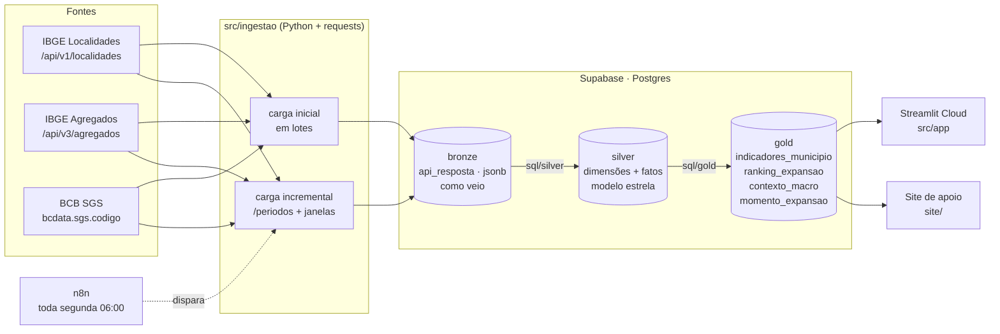
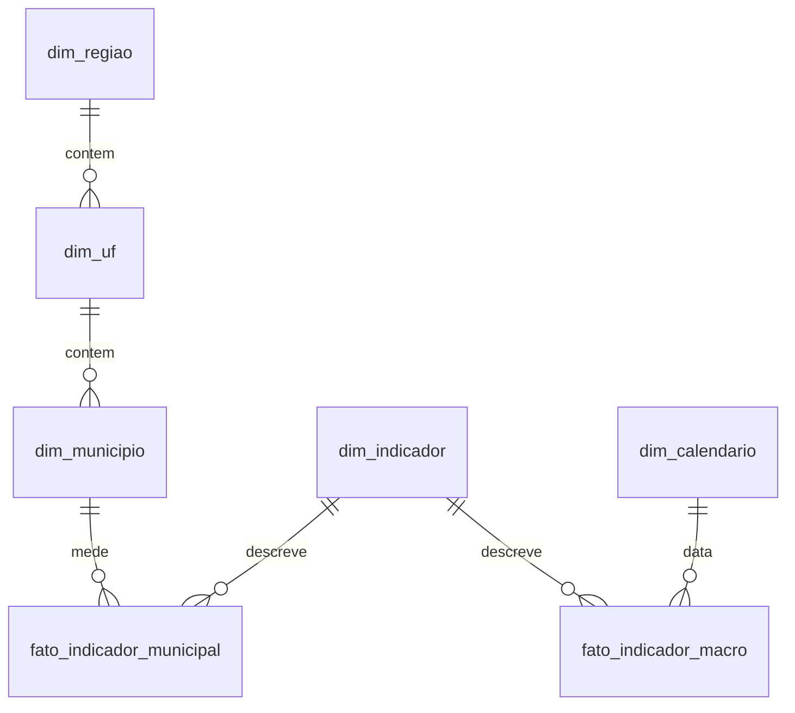
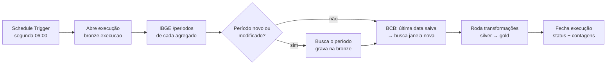

# spec.md — Especificação Técnica do Radar de Expansão

> **RASCUNHO v0.1 (26/11/2026)** — itens marcados com ⏳ dependem de decisão do squad.
> Fonte da verdade técnica do projeto: toda mudança de modelo, endpoint ou regra é registrada aqui **antes** de ir para o código.

---

## 1. Visão geral

O Radar de Expansão é um Lakehouse em três camadas (bronze → silver → gold) num único banco Postgres (Supabase),
alimentado pelas APIs públicas do IBGE e do Banco Central, atualizado semanalmente pelo n8n e consumido por um dashboard Streamlit.



**Princípios**
1. **A bronze é o cofre:** guarda o JSON exatamente como a API devolveu. Nenhuma transformação na ingestão. Só recebe `INSERT`.
2. **Rastreabilidade:** toda linha da silver guarda `bronze_id`; toda tabela da gold é recalculada a partir da silver. Dá para ir de um número do dashboard até a resposta original da API.
3. **Idempotência:** rodar a mesma carga duas vezes não duplica dado (hash na bronze, `UPSERT` na silver, recálculo completo na gold).
4. **Parâmetros no topo:** todo script tem um bloco `CONFIG` no início; credenciais só no `.env`.

---

## 2. Fontes e endpoints

### 2.1 IBGE — Localidades (`https://servicodados.ibge.gov.br/api/v1/localidades`)

| Recurso | Endpoint | Uso |
|---|---|---|
| Regiões | `/regioes` | `silver.dim_regiao` (5 linhas) |
| Estados | `/estados` | `silver.dim_uf` (27 linhas) |
| Municípios | `/municipios?view=nivelado` | `silver.dim_municipio` (5.571 linhas). JSON plano, sem aninhamento |

Armadilha conhecida: Boa Esperança do Norte-MT (`5101837`, município recente) vem com `microrregiao` nulo e não aparece em séries anteriores à sua criação.

### 2.2 IBGE — Agregados v3 (`https://servicodados.ibge.gov.br/api/v3/agregados`)

Padrão: `/{agregado}/periodos/{periodos}/variaveis/{variaveis}?localidades={nivel}[{ids}]&classificacao={cls}[{cats}]`

| Agregado | Indicador | Variáveis | Classificação | Períodos disponíveis | Nível |
|---|---|---|---|---|---|
| **6579** | População residente estimada (pessoas) | `9324` | — | 2001–2006, 2008, 2009, 2011–2021, 2024–2026 | N6 |
| **4714** | Censo 2022: população, área, densidade | `93`, `6318`, `614` | — | 2022 | N6 |
| **5938** | PIB dos Municípios a preços correntes (mil R$) | `37` | — | 2002–2023 | N6 |
| **7060** | IPCA (%) | `63` mensal, `2265` acumulado 12 meses | `315[7169]` (índice geral) | 202001–202610 | N1 |
| **10295** | Censo 2022: rendimento domiciliar per capita (R$) | `13431` média | `2[6794]\|86[95251]\|58[95253]` (totais) | 2022 | N6 |
| **9418** | Cadastro Central de Empresas por CNAE | `2585` nº de empresas | `12762[117856]` (CNAE 93.13-1) | 2022–2024 | N6 |
| **9509** | Cadastro Central de Empresas — total | `10143` salário médio mensal (R$) | — | 2022–2024 | N6 |

Endpoints auxiliares:
- `/{agregado}/metadados` — nomes, unidades, classificações e níveis territoriais.
- `/{agregado}/periodos` — lista de períodos com a data de `modificacao` → **base da carga incremental** (seção 6).

Armadilhas que o código precisa tratar:
- Valores chegam **sempre como texto**; o nome do município varia entre tabelas → usar só o código.
- População estimada **não tem 2007, 2010, 2022 e 2023**. 2022 vem do Censo (4714). 2023 é interpolado na gold (seção 5.2).
- PIB municipal sai com ~2 anos de atraso (último ano hoje: 2023) e o IBGE **revisa anos antigos** → a carga incremental precisa olhar `modificacao`, não só períodos novos.
- `periodos/all` devolve HTTP 500 → sempre listar os períodos explicitamente.
- Símbolos no lugar de número: `"-"` (zero absoluto), `"..."` (não disponível), `"X"` (sigilo estatístico), `".."` (não se aplica).

### 2.3 Validação do código CNAE das academias (chamada real em 26/11/2026)

Objetivo: confirmar o código da categoria **CNAE 93.13-1 — Atividades de condicionamento físico** na classificação 12762 do agregado 9418 e se há dado por município.

| Verificação | Chamada | Resultado |
|---|---|---|
| Categoria | `GET /api/v3/agregados/9418/metadados` | Classificação `12762` (CNAE 2.0, 1.067 categorias). **`117856` = "93.13-1 Atividades de condicionamento físico"** (nível 4 — classe). Grupo pai `117853` = "93.1 Atividades esportivas" |
| Níveis territoriais | idem | `N1`, `N2`, `N3`, **`N6` (município)** |
| Períodos | `GET /api/v3/agregados/9418/periodos` | `2022` (mod. 20/06/2024), `2023` (mod. 13/11/2025), `2024` (mod. 25/06/2026) |
| Dado por município | `GET .../9418/periodos/{ano}/variaveis/2585\|707?localidades=N6[all]&classificacao=12762[117856]` | HTTP 200 nos 3 anos, **5.570 municípios** por ano, ~1,3 MB, 11–22 s por chamada |

Conteúdo da resposta (variável 2585 — número de empresas):

| Ano | Municípios com número | Municípios com `"-"` (zero) | Total Brasil | São Paulo | Belo Horizonte | Brasília |
|---|---|---|---|---|---|---|
| 2022 | 4.417 | 1.153 | 53.711 | 3.746 | 834 | 1.181 |
| 2023 | 4.654 | 916 | 59.366 | 4.095 | 896 | 1.286 |
| 2024 | 4.816 | 754 | 65.346 | 4.500 | 1.008 | 1.329 |

**Conclusão:** o critério de concorrência é viável por município. Usar a **variável `2585` (empresas)**, que não tem sigilo.
A variável `707` (pessoal ocupado) **não serve** como critério: em 2024, 2.518 municípios vêm com `"X"` (sigilo).
Na silver, `"-"` vira nulo com flag `zero_absoluto`; na gold é lido como **0 academias**.

### 2.4 Banco Central — SGS (`https://api.bcb.gov.br/dados/serie/bcdata.sgs.{codigo}/dados`)

Parâmetros: `formato=json&dataInicial=dd/MM/aaaa[&dataFinal=dd/MM/aaaa]`. Resposta: `[{"data": "dd/MM/aaaa", "valor": "11.75"}]`.

| Série | Indicador | Periodicidade | Obrigatória |
|---|---|---|---|
| **432** | Meta da Selic (% a.a.) | diária | sim |
| **10813** | Dólar comercial — venda (R$) | dias úteis | sim |
| 433 | IPCA mensal (%) — conferência contra o IBGE 7060 | mensal | não (opcional) |

Armadilhas:
- Séries diárias: **datas obrigatórias** (sem datas → HTTP 406) e **janela máxima de 10 anos** por chamada.
- Data em formato ISO → HTTP 400. Período sem dado → **HTTP 404 = "nada novo"**, não é erro.
- A série 432 traz **datas futuras** (a meta vale até o próximo Copom).
- Código inexistente pode devolver HTTP 200 com HTML depois de ~30 s → validar `content-type: application/json` e usar timeout.
- Evitar `/ultimos/N` (limite de 20, ordem inconsistente entre séries).

---

## 3. Modelo de dados

Convenções (detalhe em `agents.md`): `snake_case`, português sem acento, chaves `*_id`, datas de controle `*_em` (`timestamptz`), dimensões `dim_*`, fatos `fato_*`.

### 3.1 Bronze — dado bruto

```sql
CREATE SCHEMA IF NOT EXISTS bronze;

-- Uma linha por chamada bem-sucedida à API. Somente INSERT.
CREATE TABLE bronze.api_resposta (
    resposta_id        bigserial    PRIMARY KEY,
    fonte              text         NOT NULL CHECK (fonte IN ('IBGE', 'BCB')),
    recurso            text         NOT NULL,          -- ex.: 'ibge_agregado_6579', 'ibge_municipios', 'bcb_sgs_432'
    endpoint           text         NOT NULL,          -- caminho chamado, sem o host
    parametros         jsonb        NOT NULL,          -- parâmetros usados (períodos, variáveis, localidades, datas)
    url                text         NOT NULL,          -- URL completa, para reproduzir a chamada
    lote               text,                           -- identificador do lote: ano, UF ou janela de datas
    modificacao_fonte  date,                           -- IBGE: campo `modificacao` do período (carga incremental)
    http_status        smallint     NOT NULL,
    payload            jsonb        NOT NULL,          -- resposta original, inteira
    payload_hash       text         NOT NULL,          -- md5 do payload: evita gravar a mesma resposta duas vezes
    execucao_id        bigint,                         -- execução que gravou (bronze.execucao)
    ingerido_em        timestamptz  NOT NULL DEFAULT now(),
    UNIQUE (recurso, lote, payload_hash)
);

-- Log de cada execução do pipeline (carga inicial, incremental, n8n).
CREATE TABLE bronze.execucao (
    execucao_id    bigserial    PRIMARY KEY,
    origem         text         NOT NULL,              -- 'manual', 'n8n'
    modo           text         NOT NULL,              -- 'inicial', 'incremental'
    iniciado_em    timestamptz  NOT NULL DEFAULT now(),
    finalizado_em  timestamptz,
    status         text         NOT NULL DEFAULT 'em_andamento',  -- 'sucesso', 'erro', 'sem_novidade'
    chamadas_ok    integer      DEFAULT 0,
    chamadas_erro  integer      DEFAULT 0,
    mensagem       text
);

-- Último período salvo por recurso: é o que o n8n compara com a API.
CREATE VIEW bronze.vw_ultimo_periodo AS
SELECT recurso, lote, max(modificacao_fonte) AS modificacao_fonte, max(ingerido_em) AS ingerido_em
FROM bronze.api_resposta
GROUP BY recurso, lote;
```

### 3.2 Silver — modelo estrela



```sql
CREATE SCHEMA IF NOT EXISTS silver;

CREATE TABLE silver.dim_regiao (
    regiao_id     smallint PRIMARY KEY,       -- 1 a 5 (código IBGE)
    regiao_sigla  char(2)  NOT NULL UNIQUE,   -- N, NE, SE, S, CO
    regiao_nome   text     NOT NULL
);

CREATE TABLE silver.dim_uf (
    uf_id      smallint PRIMARY KEY,          -- 11 a 53 (código IBGE)
    uf_sigla   char(2)  NOT NULL UNIQUE,
    uf_nome    text     NOT NULL,
    regiao_id  smallint NOT NULL REFERENCES silver.dim_regiao
);

CREATE TABLE silver.dim_municipio (
    municipio_id             integer  PRIMARY KEY,   -- 7 dígitos (código IBGE)
    municipio_nome           text     NOT NULL,
    uf_id                    smallint NOT NULL REFERENCES silver.dim_uf,
    regiao_id                smallint NOT NULL REFERENCES silver.dim_regiao,
    mesorregiao_id           integer,
    microrregiao_id          integer,                -- pode ser nulo (municípios recentes)
    regiao_intermediaria_id  integer,
    regiao_imediata_id       integer,
    bronze_id                bigint   NOT NULL,      -- bronze.api_resposta.resposta_id
    atualizado_em            timestamptz NOT NULL DEFAULT now()
);

CREATE TABLE silver.dim_calendario (
    data         date     PRIMARY KEY,               -- 2000-01-01 a 2030-12-31 (generate_series)
    ano          smallint NOT NULL,
    trimestre    smallint NOT NULL,
    mes          smallint NOT NULL,
    ano_mes      integer  NOT NULL,                  -- 202610
    nome_mes     text     NOT NULL,
    dia_semana   smallint NOT NULL,                  -- 1 = segunda ... 7 = domingo
    eh_fim_de_semana boolean NOT NULL
);

-- Catálogo dos indicadores: liga cada fato à sua origem na API.
CREATE TABLE silver.dim_indicador (
    indicador_id   text     PRIMARY KEY,   -- ex.: 'populacao_estimada', 'pib', 'academias_qtd', 'selic_meta'
    indicador_nome text     NOT NULL,
    fonte          text     NOT NULL,      -- 'IBGE' | 'BCB'
    codigo_origem  text     NOT NULL,      -- ex.: '6579/9324', '9418/2585/12762[117856]', 'sgs 432'
    unidade        text     NOT NULL,      -- 'pessoas', 'mil R$', 'R$', '%', '% a.a.', 'unidades'
    periodicidade  text     NOT NULL,      -- 'anual', 'decenal', 'mensal', 'diaria'
    descricao      text
);

CREATE TABLE silver.fato_indicador_municipal (
    municipio_id  integer  NOT NULL REFERENCES silver.dim_municipio,
    indicador_id  text     NOT NULL REFERENCES silver.dim_indicador,
    ano           smallint NOT NULL,
    valor         numeric,                              -- nulo quando a fonte mandou símbolo
    flag_valor    text     NOT NULL DEFAULT 'ok',       -- 'ok' | 'zero_absoluto' | 'nao_disponivel' | 'sigilo' | 'nao_se_aplica'
    bronze_id     bigint   NOT NULL,
    atualizado_em timestamptz NOT NULL DEFAULT now(),
    PRIMARY KEY (municipio_id, indicador_id, ano)
);

CREATE TABLE silver.fato_indicador_macro (
    indicador_id  text     NOT NULL REFERENCES silver.dim_indicador,
    data          date     NOT NULL REFERENCES silver.dim_calendario,  -- mensal: primeiro dia do mês
    valor         numeric,
    flag_valor    text     NOT NULL DEFAULT 'ok',
    bronze_id     bigint   NOT NULL,
    atualizado_em timestamptz NOT NULL DEFAULT now(),
    PRIMARY KEY (indicador_id, data)
);
```

Indicadores previstos em `dim_indicador`:

| indicador_id | Origem | Fato |
|---|---|---|
| `populacao_estimada` | IBGE 6579/9324 | municipal |
| `populacao_censo` | IBGE 4714/93 | municipal |
| `area_km2` | IBGE 4714/6318 | municipal |
| `pib` | IBGE 5938/37 (mil R$) | municipal |
| `renda_dom_per_capita` | IBGE 10295/13431 | municipal |
| `academias_qtd` | IBGE 9418/2585 · CNAE 93.13-1 | municipal |
| `salario_medio` | IBGE 9509/10143 | municipal |
| `ipca_mensal`, `ipca_12m` | IBGE 7060/63 e 2265 · 315[7169] | macro |
| `selic_meta` | BCB SGS 432 | macro |
| `dolar_venda` | BCB SGS 10813 | macro |

### 3.3 Gold — tabelas de consumo

Cada tabela responde a perguntas do `prd.md` (coluna "Pergunta").

```sql
CREATE SCHEMA IF NOT EXISTS gold;

-- P1, P3, P4: uma linha por município com os indicadores do "fator onde".
CREATE TABLE gold.indicadores_municipio (
    municipio_id              integer  PRIMARY KEY,
    municipio_nome            text     NOT NULL,
    uf_sigla                  char(2)  NOT NULL,
    regiao_sigla              char(2)  NOT NULL,
    populacao                 integer,           -- estimativa mais recente
    populacao_ano             smallint,
    populacao_censo_2022      integer,
    crescimento_pop_aa        numeric(7,4),      -- CAGR Censo 2022 → último ano (fração: 0.0123 = 1,23% a.a.)
    pib_mil_reais             numeric,           -- PIB do último ano disponível
    pib_ano                   smallint,
    pib_per_capita            numeric(12,2),     -- R$ por habitante, mesmo ano do PIB
    pib_per_capita_tendencia  numeric(7,4),      -- CAGR do PIB per capita (5 anos até pib_ano)
    renda_dom_per_capita      numeric(10,2),     -- R$/mês, Censo 2022
    academias_qtd             integer,           -- empresas CNAE 93.13-1, último ano
    academias_ano             smallint,
    academias_por_10mil_hab   numeric(8,3),
    salario_medio             numeric(10,2),     -- R$/mês, Cadastro Central de Empresas
    atualizado_em             timestamptz NOT NULL DEFAULT now()
);

-- P2, P5, P8: ranking do cliente com a nota de cada critério (0–100) e a nota final.
CREATE TABLE gold.ranking_expansao (
    municipio_id              integer  PRIMARY KEY,
    municipio_nome            text     NOT NULL,
    uf_sigla                  char(2)  NOT NULL,
    regiao_sigla              char(2)  NOT NULL,
    populacao                 integer  NOT NULL,
    nota_mercado              numeric(5,2),
    nota_poder_compra         numeric(5,2),
    nota_espaco_competitivo   numeric(5,2),
    nota_crescimento          numeric(5,2),
    nota_riqueza              numeric(5,2),
    nota_mercado_formal       numeric(5,2),
    nota_final                numeric(5,2) NOT NULL,
    posicao_brasil            integer  NOT NULL,
    posicao_uf                integer  NOT NULL,
    dados_incompletos         boolean  NOT NULL DEFAULT false,  -- algum critério recebeu nota neutra
    versao_pesos              text     NOT NULL,
    calculado_em              timestamptz NOT NULL DEFAULT now()
);

-- P8: critérios e pesos usados (alimenta a explicação do ranking no dashboard).
CREATE TABLE gold.ranking_criterio (
    criterio      text     PRIMARY KEY,   -- 'mercado', 'poder_compra', ...
    descricao     text     NOT NULL,
    fonte         text     NOT NULL,
    peso          numeric(4,3) NOT NULL,  -- soma = 1.000
    sentido       text     NOT NULL,      -- 'maior_melhor' | 'menor_melhor'
    versao_pesos  text     NOT NULL
);

-- P6, P7: evolução mensal do cenário econômico.
CREATE TABLE gold.contexto_macro (
    mes                  date PRIMARY KEY,     -- primeiro dia do mês
    selic_meta           numeric(6,2),         -- % a.a., valor vigente no último dia do mês
    selic_var_12m_pp     numeric(6,2),         -- variação em pontos percentuais contra 12 meses antes
    dolar_medio          numeric(8,4),         -- R$, média dos dias úteis do mês
    dolar_var_12m_pct    numeric(7,2),
    ipca_mensal          numeric(6,2),         -- %
    ipca_12m             numeric(6,2),         -- %
    atualizado_em        timestamptz NOT NULL DEFAULT now()
);

-- P7: "fator quando" — expandir agora, com cautela ou esperar (uma linha por mês).
CREATE TABLE gold.momento_expansao (
    mes              date PRIMARY KEY,
    sinal_juros      text NOT NULL,   -- 'verde' | 'amarelo' | 'vermelho'
    sinal_inflacao   text NOT NULL,
    sinal_cambio     text NOT NULL,
    pontuacao        smallint NOT NULL,   -- verde = +1, amarelo = 0, vermelho = -1
    recomendacao     text NOT NULL,   -- 'Expandir agora' | 'Expandir com cautela' | 'Esperar'
    justificativa    text NOT NULL,   -- frase pronta para o dashboard
    atualizado_em    timestamptz NOT NULL DEFAULT now()
);
```

Relacionamentos lógicos: `gold.*.municipio_id` → `silver.dim_municipio`; `gold.contexto_macro.mes` → `silver.dim_calendario`.

---

## 4. Regras bronze → silver

1. **Fonte única por lote:** para cada `(recurso, lote)` usa-se só a resposta mais recente da bronze (`DISTINCT ON ... ORDER BY ingerido_em DESC`).
2. **Achatar o JSON do IBGE:** `payload[] → resultados[] → classificacoes / series[] → serie{periodo: valor}`. Cada linha da silver = localidade + período + variável (+ categoria) + valor.
3. **Períodos:** `"2024"` → `ano = 2024`; `"202610"` → `data = 2026-10-01`. BCB: `"dd/MM/aaaa"` → `date`.
4. **Tipos:** texto → `numeric` (o IBGE e o BCB usam ponto decimal). Códigos de localidade → `integer`.
5. **Ausentes:** `"-"` → nulo + `zero_absoluto`; `"..."` → nulo + `nao_disponivel`; `"X"` → nulo + `sigilo`; `".."` → nulo + `nao_se_aplica`.
6. **Códigos padronizados:** `municipio_id` com 7 dígitos; `uf_id = municipio_id / 100000`; `regiao_id = uf_id / 10`. Todo fato precisa casar com `dim_municipio` (checagem de integridade ao fim da carga).
7. **Duplicados:** chave primária + `INSERT ... ON CONFLICT DO UPDATE` → a versão mais nova vence (o IBGE revisa o PIB de anos anteriores).
8. **Selic com datas futuras:** a silver guarda só `data <= current_date`; o futuro continua na bronze.
9. **Unidades preservadas:** PIB fica em mil R$ na silver (unidade em `dim_indicador`); conversões acontecem na gold.
10. **Rastreio:** toda linha leva `bronze_id`.

## 5. Regras silver → gold

### 5.1 `gold.contexto_macro` e `gold.momento_expansao`
- Selic do mês = meta vigente no último dia do mês; dólar do mês = média dos dias úteis; IPCA = variáveis 63 e 2265 do IBGE.
- Variações de 12 meses: Selic em pontos percentuais; dólar em %.
- Semáforo (limiares no `CONFIG` do script, valores iniciais a validar com o squad ⏳):

| Sinal | Verde (+1) | Amarelo (0) | Vermelho (−1) |
|---|---|---|---|
| Juros | Selic caiu ≥ 0,5 p.p. em 12 meses | variação entre −0,5 e +0,5 p.p. | Selic subiu > 0,5 p.p. |
| Inflação | IPCA 12m ≤ 4,5% e desacelerando (vs. 3 meses antes) | só uma das duas condições | IPCA 12m > 4,5% e acelerando |
| Câmbio | dólar ≤ 12 meses antes | alta de até 10% | alta > 10% |

  Pontuação = soma dos três sinais: **≥ +2 → "Expandir agora"**, **0 a +1 → "Expandir com cautela"**, **≤ −1 → "Esperar"**.

### 5.2 `gold.indicadores_municipio`
- **População:** estimativa mais recente do 6579. População de 2022 = Censo (4714). População de 2023 (inexistente na fonte) = interpolação geométrica `√(pop2022 × pop2024)`, usada só para o PIB per capita de 2023.
- **Crescimento:** `(pop_último_ano / pop_censo_2022)^(1/(último_ano − 2022)) − 1`.
  Não usar 2021 como base: as estimativas até 2021 eram projetadas a partir do Censo 2010 e ficaram acima do Censo 2022
  (Brasil: 213,3 mi estimados em 2021 × 203,1 mi recenseados em 2022), o que distorceria o crescimento.
- **PIB per capita** = `pib_mil_reais × 1000 / populacao` do mesmo ano. **Tendência** = CAGR do PIB per capita nos 5 anos até o último ano do PIB.
  Como o ranking usa percentil, deflacionar pelo IPCA não muda a ordem (a inflação é a mesma para todos os municípios).
- **Academias por 10 mil hab.** = `academias_qtd / populacao_do_mesmo_ano × 10000`; `zero_absoluto` = 0 academias.

### 5.3 `gold.ranking_expansao`
- **Universo:** municípios com população estimada ≥ 50 mil (687 municípios na estimativa de 2026). Limite no `CONFIG`.
- **Nota de cada critério:** percentil no universo × 100 (`percent_rank()`), invertido quando "menor é melhor".
- **Nota final:** soma ponderada das notas pelos pesos do `prd.md` (gravados em `gold.ranking_criterio`).
- **Dado faltante:** o critério recebe nota neutra 50 e `dados_incompletos = true`.
- **Posições:** `posicao_brasil` e `posicao_uf` por `nota_final` decrescente.
- A gold é **recalculada inteira** a cada execução (são poucos milhares de linhas).

---

## 6. Limite da API do IBGE e estratégia de lotes

O IBGE não documenta o limite, mas nos testes ele fica em **≈ 100 mil valores por chamada**
(valores = períodos × variáveis × localidades × categorias). Acima disso a API devolve HTTP 500 genérico.

Regra do código (`CONFIG: LIMITE_VALORES_POR_CHAMADA = 50_000`, metade do limite como margem):
1. Estimar o tamanho da chamada antes de fazer.
2. Se passar do limite: dividir **por ano**; se um ano ainda passar, dividir **por UF** (`N6[N3[uf]]`).
3. Cada lote é uma linha na bronze (`lote = '2024'` ou `lote = '2024-MG'`).

| Agregado | Lote padrão | Valores por chamada |
|---|---|---|
| 6579 população | 1 ano × N6[all] | ≈ 5.570 |
| 5938 PIB | 1 ano × N6[all] | ≈ 5.570 |
| 9418 CNAE 93.13-1 | 1 ano × N6[all] × 1 categoria | ≈ 5.570 (11–22 s) |
| 9509 salário médio | 1 ano × N6[all] | ≈ 5.570 |
| 4714 / 10295 Censo | carga única × N6[all] | ≤ 16.710 |
| 7060 IPCA | todos os meses × N1 | < 200 |

Boas práticas de chamada: timeout de 60 s (120 s para o 9418), 3 tentativas com espera crescente (2 s, 4 s, 8 s),
validar `content-type: application/json`, `User-Agent` próprio do projeto e `try/except` com registro em `bronze.execucao`.

## 7. Carga de dados novos (incremental)

| Fonte | Carga inicial | Carga incremental (semanal) |
|---|---|---|
| Localidades | 1 chamada por recurso | recarga completa (barata); a silver atualiza por `UPSERT` |
| Agregados anuais (6579, 5938, 9418, 9509) | 1 chamada por ano | `GET /{agregado}/periodos` → compara `id` e `modificacao` com `bronze.vw_ultimo_periodo` → baixa só período **novo** ou **modificado** |
| Censo (4714, 10295) | carga única | só se `/periodos` mostrar `modificacao` mais nova |
| IPCA (7060) | todo o histórico numa chamada | `periodos/-3` (últimos 3 meses) + `UPSERT` |
| BCB diárias (432, 10813) | janelas de até 10 anos desde `DATA_INICIO` (CONFIG, proposta: 01/01/2015) | `dataInicial = última data salva − 30 dias`, sem `dataFinal`; HTTP 404 = nada novo |

Depois de gravar na bronze, a execução roda `silver` → `gold` só se houve resposta nova; senão registra `status = 'sem_novidade'`.

## 8. Automação (n8n)

Workflow `n8n/radar-expansao.json` (exportado **sem credenciais**):



⏳ **Onde o n8n roda e como chama o código** (decisão do squad):
- **Opção A (recomendada):** o n8n faz as chamadas HTTP e grava na bronze pelo nó Postgres; as transformações silver/gold ficam como
  funções SQL versionadas em `sql/` e são chamadas pelo próprio n8n. Funciona em qualquer n8n (nuvem ou local) e o código Python reaproveita as mesmas funções.
- **Opção B:** n8n local (Docker) com o nó *Execute Command* chamando os scripts Python. Um único caminho de código, mas exige Python dentro do container do n8n.

## 9. Dashboard (Streamlit) e site de apoio

- `src/app/app.py` lê **só a gold** (conexão via `st.secrets` no Streamlit Cloud, `.env` local).
- Páginas: **Ranking** (filtros por região e UF, top N) · **Município** (ficha com os indicadores e as notas) ·
  **Momento econômico** (Selic, câmbio e IPCA no tempo + semáforo) · **Como o ranking é calculado** (critérios, pesos e fontes).
- Site de apoio em `site/`: documentação + vitrine de dados, lendo arquivos exportados da gold. ⏳ Stack a definir pelo squad.

## 10. Stack e como rodar

| Camada | Ferramenta |
|---|---|
| Linguagem | Python 3.11+ (`requests`, `pandas`, `SQLAlchemy`, `psycopg2-binary`, `python-dotenv`) |
| Banco | Supabase (Postgres) com schemas `bronze`, `silver`, `gold` |
| Automação | n8n |
| Dashboard | Streamlit + Plotly, publicado no Streamlit Cloud |
| Versionamento | Git + GitHub (repositório público) |

**Conexão com o Supabase — Session pooler**

A conexão direta do Supabase (`db.<project-ref>.supabase.co`) é **só IPv6** e falha em várias redes domésticas e no Streamlit Cloud.
Por isso todos os componentes (scripts Python, n8n e Streamlit) usam o **Session pooler**, que aceita IPv4:

| Variável (`.env`) | Valor | Observação |
|---|---|---|
| `DB_HOST` | `aws-0-<regiao>.pooler.supabase.com` | região do projeto no Supabase |
| `DB_PORT` | `5432` | porta do Session pooler (o Transaction pooler, 6543, não é usado) |
| `DB_NAME` | `postgres` | |
| `DB_USER` | `postgres.<project-ref>` | o usuário leva o ref do projeto depois do ponto |
| `DB_PASSWORD` | senha do banco | só no `.env` local; no Streamlit Cloud vai em *Secrets*; no n8n, numa credencial Postgres |

A conexão usa SSL (`sslmode=require`), definido no código de conexão.

Roteiro previsto (nomes dos scripts podem mudar; este arquivo será atualizado junto):

```powershell
# 1. Ambiente
git clone https://github.com/JJ-Junior/radar-expansao.git
cd radar-expansao
python -m venv .venv
.\.venv\Scripts\Activate.ps1
pip install -r requirements.txt
Copy-Item .env.example .env          # preencher com as credenciais do Supabase

# 2. Criar schemas e tabelas (ou colar os arquivos no SQL Editor do Supabase)
python -m src.transformacao.criar_estrutura

# 3. Carga inicial na bronze (em lotes)
python -m src.ingestao.carga_inicial

# 4. Bronze → silver → gold
python -m src.transformacao.executar

# 5. Dashboard
streamlit run src/app/app.py
```

## 11. Pendências deste rascunho

- ⏳ Onde o n8n roda (seção 8).
- ✅ Supabase: conexão pelo Session pooler (seção 10); conta em criação.
- ⏳ Limiares do semáforo macro (seção 5.1).
- ⏳ Stack do site de apoio (seção 9).
- ⏳ Data de início do histórico do BCB (proposta: 01/01/2015).
